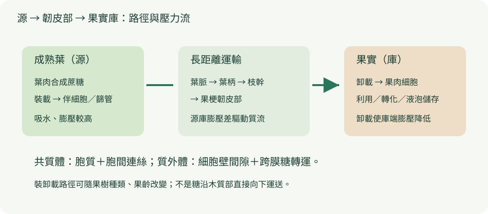

# 101 年果樹學｜逐題教學詳解

共 9 大題，小題合併於各大題。先理解原理，再練寫答案。配分重點為建議架構，不代表官方閱卷細則。

## 第一題｜幼小木瓜呼吸率零（10 分）

### 題意與作答範圍

本題重點：**幼小木瓜呼吸率零**。下列依題目主題整理答案；題幹、選項與圖表請對照[原始試卷](../../541491416.pdf#page=16)。

### 先掌握答案

健康活的幼果須呼吸以供細胞分裂與生長，真正呼吸率不應為零。先查儀器校正、漏氣、流量、取樣時間、CO₂ 背景扣除與秤重；

### 原理拆解：為什麼會這樣？

**先檢查測的是總量還是淨量**

幼木瓜細胞仍在分裂、生長與吸收養分，必須進行能量代謝。若題目聲稱呼吸為零，應檢查單位鮮重與單果尺度、光下 CO₂ 再固定、採樣時段、儀器靈敏度及背景扣除。科學作答應由生理需求提出可驗證的替代解釋，而不是把不合理數字當成定律。

**幼嫩組織必須有能量來源**

細胞分裂、離子吸收及生合成都需要 ATP，幼果並不因體積小就停止呼吸。討論呼吸資料須區分單位重量呼吸率、單果總量、淨氣體交換與檢測極限。

**量測到零不代表生理上不存在**

光下固定 CO₂ 可能抵銷呼吸釋放，儀器不夠靈敏或計算基準不同也會使數值近零。應檢查暗測或光測、鮮重與時間單位、空白校正及組織是否活體，而不是直接接受不合理結論。

**呼吸高峰需連同成熟階段解釋**

更年性果實的成熟呼吸上升與自催化乙烯有關，但單見呼吸上升仍須排除傷害、溫度或病原。非更年性不等於不呼吸，也不等於完全不對乙烯產生任何反應。

### 可直接練寫的完整答案

健康活的幼果須呼吸以供細胞分裂與生長，真正呼吸率不應為零。先查儀器校正、漏氣、流量、取樣時間、CO₂ 背景扣除與秤重；

幼綠果若在光下量測，果皮光合可抵銷部分 CO₂ 釋放而使淨交換近零。須在暗處量測並做空白與適當重複，區分總呼吸與淨 CO₂ 交換。

幼木瓜細胞仍在分裂、生長與吸收養分，必須進行能量代謝。若題目聲稱呼吸為零，應檢查單位鮮重與單果尺度、光下 CO₂ 再固定、採樣時段、儀器靈敏度及背景扣除。科學作答應由生理需求提出可驗證的替代解釋，而不是把不合理數字當成定律。

### 實例：把原理用在情境中

木瓜幼果若測得淨 CO₂ 釋放接近零，先比較暗中量測與光下量測，再確認是每克還是每果；不能據此斷言幼果不需要能量。

### 配分重點：哪些內容不能漏？

10 分：不合理判斷、淨交換與光合、儀器／操作、驗證方式。

- **不合理判斷**
- **淨交換與光合**
- **儀器／操作**
- **驗證方式**

細項為依題意整理的建議得分內容，並非校方公布的評分細則。作答時依原題小題順序，讓定義、機制、實例與管理措施互相對應。

### 常見錯誤與修正

- 把淨交換為零寫成粒線體停止代謝。

## 第二題｜柑橘是否適合真空預冷（10 分）

### 題意與作答範圍

本題重點：**柑橘是否適合真空預冷**。下列依題目主題整理答案；題幹、選項與圖表請對照[原始試卷](../../541491416.pdf#page=16)。

### 先掌握答案

通常不以真空預冷為首選。柑橘表皮與蠟層對水分散失阻力較高，果實表面積／體積低，減壓蒸發難快速帶走果心熱量，過程還可能增加失水；

### 原理拆解：為什麼會這樣？

**先分清預冷與冷藏**

採收時產品常接近田間溫度；若只把大量溫熱貨物放進冷庫，外層先冷、箱內與果心仍熱，呼吸及失水會持續。預冷的目標是迅速降低產品溫度，冷藏則是把已降溫的產品維持在適溫，兩者目的與設備負荷不同。

**冷得快，必須讓熱有出口**

壓差預冷靠風扇建立壓差，迫使冷空氣穿過箱孔與產品間隙；箱孔不對齊或氣流短路時，庫溫低也不代表果心降得快。水冷以冷水接觸傳熱，但要控制水質與交叉污染。真空預冷則降低氣壓，使組織水分在低溫蒸發，帶走潛熱。

**依器官結構選方法**

葉菜表面積相對大，真空法常有效；大果實的果心熱須先傳到外層，表皮又限制蒸發，因此真空法可能慢且失重。方法選定後，還須量果心或代表部位溫度，訂冷卻終點，而不是只記處理分鐘。

### 可直接練寫的完整答案

通常不以真空預冷為首選。柑橘表皮與蠟層對水分散失阻力較高，果實表面積／體積低，減壓蒸發難快速帶走果心熱量，過程還可能增加失水；

壓差預冷較能兼顧通用性與包裝處理。是否採用須以實際冷卻、失重及品質測試判斷。

採收時產品常接近田間溫度；若只把大量溫熱貨物放進冷庫，外層先冷、箱內與果心仍熱，呼吸及失水會持續。預冷的目標是迅速降低產品溫度，冷藏則是把已降溫的產品維持在適溫，兩者目的與設備負荷不同。

壓差預冷靠風扇建立壓差，迫使冷空氣穿過箱孔與產品間隙；箱孔不對齊或氣流短路時，庫溫低也不代表果心降得快。水冷以冷水接觸傳熱，但要控制水質與交叉污染。真空預冷則降低氣壓，使組織水分在低溫蒸發，帶走潛熱。

### 實例：把原理用在情境中

包裝場可將同一箱產品放置多點溫度計，畫降溫曲線，比較箱心與外側。這能檢查通氣孔、堆裝與風量是否合適，也可同時量失重，避免用犧牲水分換取冷卻速度。

| 方法 | 主要傳熱機制 | 判斷重點 |
| --- | --- | --- |
| 房冷 | 自然或一般循環冷空氣 | 便宜但箱心降溫較慢 |
| 壓差 | 強制冷氣穿箱 | 箱孔與氣流路徑 |
| 水冷 | 冷水接觸傳熱 | 耐水性與水衛生 |
| 真空 | 減壓蒸發吸熱 | 表面積、失水與器官構造 |

### 配分重點：哪些內容不能漏？

10 分：判斷、表皮與體積比、蒸發及果心傳熱、替代方法。

- **表皮與體積比**
- **蒸發及果心傳熱**
- **替代方法**

細項為依題意整理的建議得分內容，並非校方公布的評分細則。作答時依原題小題順序，讓定義、機制、實例與管理措施互相對應。

### 常見錯誤與修正

- 把預冷寫成單純放進冰箱，沒有交代移除田間熱。

## 第三題｜無酸橙嫁接不同砧木的酸度（5 分）

### 題意與作答範圍

本題重點：**無酸橙嫁接不同砧木的酸度**。下列依題目主題整理答案；題幹、選項與圖表請對照[原始試卷](../../541491416.pdf#page=16)。

### 先掌握答案

接穗基因型主要決定低酸特性，砧木可藉水分、礦養、樹勢、成熟速度及糖酸代謝改變酸度表現，故可有量的差異，但不應認為接上酸橙就因砧木味酸而必然變酸。比較時需同成熟度、負載、土壤與採期，測可滴定酸度而非僅嚐味。

### 原理拆解：為什麼會這樣？

**嫁接不能把接穗當成換了品種**

果實有機酸合成、分解及液泡累積主要受接穗基因與生育環境調控，砧木可經水分、礦養與樹勢間接改變酸度，卻不能合理預期把無酸橙接在酸砧就直接變成酸橙品種。試驗應以相同接穗、不同砧木、相同成熟度及重複樹比較，避免把成熟度差異誤當成遺傳轉換。

**形成層接觸是癒合的重要基礎**

砧穗需健康且具親和性，切面平整並避免失水與污染。粗細不一致時至少對準一側形成層，不是只把木質部中心對在一起；綁紮須固定且不造成後續勒傷。

**從癒傷橋到維管束連續**

傷口附近細胞增生形成癒傷組織，接觸後建立連接，進一步形成連續形成層並分化新木質部與韌皮部，才逐漸恢復供水與同化物運輸。接穗短期萌芽可使用原存養分，不足以證明已成功癒合。

**成功還包含長期親和性**

砧木可影響樹勢、抗逆、礦養與成熟，但通常不會把接穗果實的基因型改成砧木品種。若有延遲不親和，早期成活後仍可能在接口或樹勢上出問題，須持續觀察。

**三種酵素要看反應而非只背名稱**

轉化酶水解蔗糖，生成葡萄糖與果糖；蔗糖合成酶可逆地轉換蔗糖與 UDP-葡萄糖、果糖，在許多庫組織常參與裂解；蔗糖磷酸合成酶則參與蔗糖合成。不能因名稱含「合成」就斷定反應在所有組織一定只向合成方向。

**酵素改變糖種類，也影響庫的吸引力**

庫端把蔗糖裂解可維持輸入梯度、供呼吸和細胞壁合成，己糖也具滲透與訊號作用。若成熟期蔗糖合成加強、分解下降並有足夠運入，就可能較多累積蔗糖；但結果仍受細胞區室及液泡運輸限制。

**不可用一次活性推全部品質**

應比較發育時序、酵素位置、糖總量與含水。糖度較高可能因水少，不必然是酵素使糖總量提高；有機酸也受合成、呼吸利用與液泡貯藏影響，需與糖酸比、風味一起判讀。

### 可直接練寫的完整答案

接穗基因型主要決定低酸特性，砧木可藉水分、礦養、樹勢、成熟速度及糖酸代謝改變酸度表現，故可有量的差異，但不應認為接上酸橙就因砧木味酸而必然變酸。比較時需同成熟度、負載、土壤與採期，測可滴定酸度而非僅嚐味。

果實有機酸合成、分解及液泡累積主要受接穗基因與生育環境調控，砧木可經水分、礦養與樹勢間接改變酸度，卻不能合理預期把無酸橙接在酸砧就直接變成酸橙品種。試驗應以相同接穗、不同砧木、相同成熟度及重複樹比較，避免把成熟度差異誤當成遺傳轉換。

### 實例：把原理用在情境中

切接後接穗先抽芽但隨後萎凋，可能是儲藏養分暫時支持萌芽，維管束卻未充分連接；應回查形成層對準、保濕與砧穗親和。

研究上可同測蔗糖、葡萄糖、果糖的含量與相關酵素，若只有轉化酶較高而糖輸入不足，仍不能推定成熟果一定更甜。

### 配分重點：哪些內容不能漏？

5 分：接穗主導、砧木間接效應、控制成熟度。

- **接穗主導**
- **砧木間接效應**
- **控制成熟度**

細項為依題意整理的建議得分內容，並非校方公布的評分細則。作答時依原題小題順序，讓定義、機制、實例與管理措施互相對應。

### 常見錯誤與修正

- 只對準髓部，忽略形成層。
- 把蔗糖合成酶等同只能合成蔗糖。

## 第四題｜果樹缺鈣的遺傳與環境（15 分）

### 題意與作答範圍

本題重點：**果樹缺鈣的遺傳與環境**。下列依題目主題整理答案；題幹、選項與圖表請對照[原始試卷](../../541491416.pdf#page=16)。

### 先掌握答案

品種間果實輸鈣、果重、生長速率、木質部連結及細胞壁需求不同，因而缺鈣敏感度不同。環境上水分波動、低根活力、高氮徒長、大果低負載與 K、Mg、NH₄⁺ 競爭可降低果實鈣供應；

### 原理拆解：為什麼會這樣？

**鈣的結構與訊號角色**

鈣參與細胞壁果膠交聯、膜穩定與細胞訊號。缺鈣組織容易失去完整性，因此常見生長點、新葉或果實局部壞死；但症狀位置須配合實際器官與品種，不能只靠名稱就確診。

**為何土壤有鈣，果實仍缺鈣**

鈣主要隨木質部水流輸送，韌皮部再移動能力低。葉片蒸散強，果實蒸散弱，又可能隨發育降低木質部連結，因此果端等部位會先供應不足。高氮旺長、水分波動、根傷及高銨或其他陽離子競爭會加重分配失衡。

**改善要處理運輸瓶頸**

先確認土水與組織分析，再穩定灌排、維護根活力、平衡氮鉀鎂並調整負載。直接補鈣是否有效，還要看果皮吸收、時期與藥害風險；只在土中加很多鈣，不保證能送達已缺鈣的果實部位。

### 可直接練寫的完整答案

品種間果實輸鈣、果重、生長速率、木質部連結及細胞壁需求不同，因而缺鈣敏感度不同。環境上水分波動、低根活力、高氮徒長、大果低負載與 K、Mg、NH₄⁺ 競爭可降低果實鈣供應；

應選適地品種、穩定肥水並調整負載，而非只補土壤總鈣。

鈣參與細胞壁果膠交聯、膜穩定與細胞訊號。缺鈣組織容易失去完整性，因此常見生長點、新葉或果實局部壞死；但症狀位置須配合實際器官與品種，不能只靠名稱就確診。

鈣主要隨木質部水流輸送，韌皮部再移動能力低。葉片蒸散強，果實蒸散弱，又可能隨發育降低木質部連結，因此果端等部位會先供應不足。高氮旺長、水分波動、根傷及高銨或其他陽離子競爭會加重分配失衡。

### 實例：把原理用在情境中

蘋果苦痘與番茄尻腐都能用「局部供鈣不足」理解；兩者作物及器官不同，卻共同說明營養障礙不能只看土壤總含量。

### 配分重點：哪些內容不能漏？

15 分：遺傳、生理運輸、環境競爭及管理。

- **生理運輸**
- **環境競爭及管理**

細項為依題意整理的建議得分內容，並非校方公布的評分細則。作答時依原題小題順序，讓定義、機制、實例與管理措施互相對應。

### 常見錯誤與修正

- 以為鈣能像氮一樣由老葉大量移到缺鈣果實。

## 第五題｜五組名詞（10 分）

### 題意與作答範圍

本題重點：**五組名詞**。下列依題目主題整理答案；題幹、選項與圖表請對照[原始試卷](../../541491416.pdf#page=16)。

### 先掌握答案

Apoplast transport 質外體運輸為細胞壁與胞間隙路徑；

chilling requirement 需冷量為解除內生休眠的有效低溫累積；

macronutrients／micronutrients 大量／微量元素以植物需求量區分，不是重要性；

nitrate／ammonium 硝態／銨態氮；

deciduous fruit crops 落葉果樹如梨、桃，於不利季節規律落葉。

### 原理拆解：為什麼會這樣？

**第一步是分清吸收、運輸與需求**

營養元素必須以可吸收形式到達根或葉表，再跨膜進入組織。總土壤含量、有效態與植物組織含量並不相同；pH、氧化還原、吸附沉澱及離子競爭都可造成供應瓶頸。

**用新老葉位置推理**

容易由老葉再移動的元素，如氮、鉀與鎂，缺乏時常先犧牲老葉；難再移動的鐵、鈣等，常先影響幼葉或新生器官。還需分脈間黃化、葉緣壞死或均勻失綠，才能縮小候選範圍。

**最後必須用適當樣本驗證**

依作物固定葉齡、枝位、季節與結果狀態，多株採代表樣；病症與正常對照分開，避免噴肥與泥土污染。診斷應把組織、土壤、水質與根系資料放在一起，排除病害、鹽害與生長稀釋，才決定施肥。

**用限制來源分類**

相關休眠的抑制來自芽外，如頂芽優勢；內生休眠來自芽自身，即使外面適宜仍難萌；環境休眠則是芽已有能力，但外界低溫或缺水限制。三者不能以落葉與否判斷，也不必在同株所有芽同時發生。

**冬天的冷與春天的暖做不同工作**

有效低溫累積可逐漸解除內生休眠，稱滿足需冷；解除後，芽仍須合適環境及一定熱量才能萌發。因此短暫暖冬回溫可能促進已滿冷的芽，卻無法補救尚未滿足需冷的芽。

**技術必須對應真正瓶頸**

摘心只能解除相關抑制，不能保證解除內生休眠；低需冷品種與冷地花芽穗可用來適應暖地，但花芽後續仍需合適熱量與授粉。成花誘導的低溫反應也不宜直接與落葉果樹的芽休眠需冷完全畫等號。

### 逐項辨析：定義之外還要知道什麼

| 本題答案項目 | 解析與辨別重點 |
| --- | --- |
| Apoplast transport 質外體運輸為細胞壁與胞間隙路徑； | 質外體路徑遇到選擇性膜界面時仍須跨膜運輸，不能理解為糖可一路無限制穿過所有組織。 |
| deciduous fruit crops 落葉果樹如梨、桃，於不利季節規律落葉。 | 電導度反映可溶鹽類總量的相關指標，不能單獨判定是哪一元素缺乏或過量。 |

### 可直接練寫的完整答案

Apoplast transport 質外體運輸為細胞壁與胞間隙路徑；

chilling requirement 需冷量為解除內生休眠的有效低溫累積；

macronutrients／micronutrients 大量／微量元素以植物需求量區分，不是重要性；

nitrate／ammonium 硝態／銨態氮；

deciduous fruit crops 落葉果樹如梨、桃，於不利季節規律落葉。

營養元素必須以可吸收形式到達根或葉表，再跨膜進入組織。總土壤含量、有效態與植物組織含量並不相同；pH、氧化還原、吸附沉澱及離子競爭都可造成供應瓶頸。

### 實例：把原理用在情境中

老葉脈間黃化與幼葉脈間黃化，外觀同樣「黃」，卻分別較支持缺鎂與缺鐵。這正是元素移動性有助判讀、但仍不能替代分析的例子。

平地高接梨把已在冷地完成所需低溫的花芽穗帶到暖地，利用當地較早回暖開花結果；不是讓高需冷芽在低地神奇地不再需要低溫。

### 配分重點：哪些內容不能漏？

10 分：五組定義、比較與例。

- **五組定義**
- **比較與例**

細項為依題意整理的建議得分內容，並非校方公布的評分細則。作答時依原題小題順序，讓定義、機制、實例與管理措施互相對應。

### 常見錯誤與修正

- 只寫缺肥會黃葉，沒有指出葉齡與黃化分布。
- 把需冷不足與萌芽後霜害混為同一問題。
- 只抄中文名稱，漏掉題目要求的構造、英文、例子或區別。

## 第六題｜依水勢圖推論文旦 RDI（13 分）

### 題意與作答範圍

本題重點：**依水勢圖推論文旦 RDI**。下列依題目主題整理答案；題幹、選項與圖表請對照[原始試卷](../../541491416.pdf#page=16)。

### 先掌握答案

提高糖度宜選果實膨大已趨緩的採前成熟期，使輕度缺水抑制稀釋與營養生長而仍保有葉片供碳。圖示細胞擴張、細胞壁及蛋白合成先受影響，較嚴重時氣孔與光合亦下降；

### 原理拆解：為什麼會這樣？

**RDI 的核心是選期與可控制**

調節性限制灌溉不是隨意少澆水，而是依發育階段對缺水敏感度不同，刻意在較可容忍階段降低供水，並設定監測及補水門檻。成功指標應同時看節水、產量、果徑、品質和下一期樹勢。

**為何輕度缺水可能有利**

細胞擴張對膨壓降低較敏感，常早於嚴重光合下降而受抑。輕度限灌因此可能減少徒長和果實水分稀釋，配合滲透調節改變溶質濃度。但糖度是濃度，糖度上升不一定代表每果糖總量增加。

**文旦如何選階段**

花期、幼果與快速膨大期缺水容易影響著果、細胞生長及果重；膨大已趨緩的採前成熟階段，才較適合評估限灌。須合併雨量、土壤、根深、負載與水勢監測，若葉片持續失水、落葉或光合受重損，就已超出改善品質的合理範圍。

### 可直接練寫的完整答案

提高糖度宜選果實膨大已趨緩的採前成熟期，使輕度缺水抑制稀釋與營養生長而仍保有葉片供碳。圖示細胞擴張、細胞壁及蛋白合成先受影響，較嚴重時氣孔與光合亦下降；

ABA 及溶質累積有助節水與滲透調節。因此限灌須控制在可恢復、尚不顯著損害碳同化範圍。

調節性限制灌溉不是隨意少澆水，而是依發育階段對缺水敏感度不同，刻意在較可容忍階段降低供水，並設定監測及補水門檻。成功指標應同時看節水、產量、果徑、品質和下一期樹勢。

細胞擴張對膨壓降低較敏感，常早於嚴重光合下降而受抑。輕度限灌因此可能減少徒長和果實水分稀釋，配合滲透調節改變溶質濃度。但糖度是濃度，糖度上升不一定代表每果糖總量增加。

### 實例：把原理用在情境中

可比較充分灌溉與採前適度限灌的果實糖度、果重、汁率及單果糖量。若只有糖度較高而果重、汁率明顯下降，便不能直接宣稱總品質與收益皆改善。

### 配分重點：哪些內容不能漏？

13 分：時期 5 分，圖中敏感度排序與 ABA／糖機制 8 分。

細項為依題意整理的建議得分內容，並非校方公布的評分細則。作答時依原題小題順序，讓定義、機制、實例與管理措施互相對應。

### 常見錯誤與修正

- 不管生育期一律斷水。

## 第七題｜矮砧蘋果高生產力（12 分）

### 題意與作答範圍

本題重點：**矮砧蘋果高生產力**。下列依題目主題整理答案；題幹、選項與圖表請對照[原始試卷](../../541491416.pdf#page=16)。

### 先掌握答案

M9、M26 等矮砧可限制主幹與枝梢生長、促早結果，使細長小冠適合密植，單位土地較早形成有效受光葉面積，增加果實分配而減骨架消耗。可能涉及水力傳導、根冠比及激素訊號，並非只有「根小吸肥少」；

### 原理拆解：為什麼會這樣？

**產量要以單位土地和有效葉面積看**

大樹不一定比小冠密植高產，因為冠內葉片可能長期受陰。產量與品質取決土地截光、光分布、葉片利用效率，以及同化物分給果實的比例；單株產量與每公頃產量必須分別討論。

**整枝、修剪和負載互相制約**

整枝建立骨架與結果部位，修剪移除特定枝芽葉，拉枝改變角度與優勢，疏果降低庫競爭。操作須保留足量健康葉；過重剪雖降低高度，卻會減供碳並促旺梢，不保證提高當期花果。

**矮化與密植的效益有條件**

矮砧、低幹與細長冠可早形成土地有效葉面積、方便作業，且減大型骨架消耗；但過密仍會陰蔽、著色差與病害。支架、灌溉、疏果及持續更新是技術成本，不應只列早產優點。

### 可直接練寫的完整答案

M9、M26 等矮砧可限制主幹與枝梢生長、促早結果，使細長小冠適合密植，單位土地較早形成有效受光葉面積，增加果實分配而減骨架消耗。可能涉及水力傳導、根冠比及激素訊號，並非只有「根小吸肥少」；

須支架、水肥和疏果支持。

大樹不一定比小冠密植高產，因為冠內葉片可能長期受陰。產量與品質取決土地截光、光分布、葉片利用效率，以及同化物分給果實的比例；單株產量與每公頃產量必須分別討論。

整枝建立骨架與結果部位，修剪移除特定枝芽葉，拉枝改變角度與優勢，疏果降低庫競爭。操作須保留足量健康葉；過重剪雖降低高度，卻會減供碳並促旺梢，不保證提高當期花果。

### 實例：把原理用在情境中

矮砧蘋果密植常可提高早期每公頃產量，即使單株產量較低；若後期冠層封閉卻不調枝，早期優勢會被陰蔽與品質下降抵銷。

### 配分重點：哪些內容不能漏？

12 分：砧穗生理、早結果、截光、分配及栽培配套。

- **砧穗生理**
- **早結果**
- **分配及栽培配套**

細項為依題意整理的建議得分內容，並非校方公布的評分細則。作答時依原題小題順序，讓定義、機制、實例與管理措施互相對應。

### 常見錯誤與修正

- 把修剪一律理解為越重越好。

## 第八題｜源至果肉貯藏細胞（15 分）

### 題意與作答範圍

本題重點：**源至果肉貯藏細胞**。下列依題目主題整理答案；題幹、選項與圖表請對照[原始試卷](../../541491416.pdf#page=16)。

### 先掌握答案

葉肉產生糖後由共質體或質外體裝載進伴細胞—篩管，源端吸水建立壓力，經葉脈、葉柄、枝幹、果梗韌皮部至果實卸載，果肉吸收並代謝或送入液泡。調控包含 H⁺-ATPase、蔗糖運輸蛋白、胞間連絲、糖裂解酵素、液泡轉運及庫生長。

### 原理拆解：為什麼會這樣？

**先把源與庫接起來**

成熟葉通常是淨輸出同化物的源，果實、幼芽及根等是利用或貯藏同化物的庫。糖由葉肉到小葉脈，經伴細胞—篩管裝載，沿葉柄、枝幹與果梗韌皮部運輸，到果實卸載再由果肉利用或存入液泡。

**壓力流與跨膜運輸不是同一層次**

源端糖裝載降低水勢，吸水建立較高膨壓；庫端卸糖降低壓力，形成長距離質流。共質體路徑走胞間連絲，質外體路徑需糖跨膜轉運；H⁺-ATPase 建立電化學梯度，可支援 H⁺／蔗糖共運輸。

**庫強決定競爭，不只看果實大小**

庫強可概念化為庫大小乘單位活性，受細胞數、膨大、種子激素、維管連結及糖分解貯藏能力影響。其他果實與新梢亦競爭同化物；疏果能增加單果分配，但過度疏果降低總收量，需在品質與產量間取捨。

### 可直接練寫的完整答案

葉肉產生糖後由共質體或質外體裝載進伴細胞—篩管，源端吸水建立壓力，經葉脈、葉柄、枝幹、果梗韌皮部至果實卸載，果肉吸收並代謝或送入液泡。調控包含 H⁺-ATPase、蔗糖運輸蛋白、胞間連絲、糖裂解酵素、液泡轉運及庫生長。

成熟葉通常是淨輸出同化物的源，果實、幼芽及根等是利用或貯藏同化物的庫。糖由葉肉到小葉脈，經伴細胞—篩管裝載，沿葉柄、枝幹與果梗韌皮部運輸，到果實卸載再由果肉利用或存入液泡。

源端糖裝載降低水勢，吸水建立較高膨壓；庫端卸糖降低壓力，形成長距離質流。共質體路徑走胞間連絲，質外體路徑需糖跨膜轉運；H⁺-ATPase 建立電化學梯度，可支援 H⁺／蔗糖共運輸。

### 圖解輔助

示意圖用來理解結構與方向；考場仍須依原題標示軸名、箭頭或構造。

### 實例：把原理用在情境中

同一樹上果實負載增加，若健康受光葉量不變，單果可分得的碳可能下降。這能解釋為何保葉、疏果與控制徒長枝，常比單獨追加「甜果肥」更重要。

### 配分重點：哪些內容不能漏？

15 分：完整組織路徑、裝卸載兩途徑、壓力流、膜與酵素調控。

- **完整組織路徑**
- **裝卸載兩途徑**
- **壓力流**
- **膜與酵素調控**

細項為依題意整理的建議得分內容，並非校方公布的評分細則。作答時依原題小題順序，讓定義、機制、實例與管理措施互相對應。

### 常見錯誤與修正

- 把長距離糖運輸寫成主要沿木質部。

## 第九題｜乙烯受器與後熟（10 分）

### 題意與作答範圍

本題重點：**乙烯受器與後熟**。下列依題目主題整理答案；題幹、選項與圖表請對照[原始試卷](../../541491416.pdf#page=16)。

### 先掌握答案

未結合乙烯的受體啟動負調節，抑制下游成熟訊號；

### 原理拆解：為什麼會這樣？

**成熟反應與乙烯感受**

乙烯是氣態激素，與受體結合後解除受體對下游的負調節，經訊號與轉錄調控影響軟化、色素、香氣及衰老。反應取決種類、果齡、溫度、濃度與時間，不是所有組織都以相同方式回應。

**更年性與非更年性要比較反應型態**

具後熟能力的更年性果實，外源乙烯可啟動自催化乙烯與呼吸躍升，常主要改變高峰出現時間。非更年性也可能暫時增加呼吸或脫綠，但通常不發展同樣的自催化成熟程序；移除乙烯後的反應因此重要。

**催熟與延後成熟都不能忽略品質**

乙烯可整齊催熟已達生理成熟的果，卻不能讓極幼果補足田間累積不足的乾物；1-MCP 阻斷感受可延緩部分產品老化，但過強處理可能影響正常後熟。脫綠、果肉軟化和增甜亦不是必然同步。

### 可直接練寫的完整答案

未結合乙烯的受體啟動負調節，抑制下游成熟訊號；

乙烯結合後解除抑制，EIN2／EIN3 等促進相關轉錄，活化乙烯生合成、細胞壁分解、色素及香氣途徑。更年性果實由此形成自催化放大；

低溫、抑制乙烯生成或用 1-MCP 阻感可延緩，但需保留正常後熟能力。

乙烯是氣態激素，與受體結合後解除受體對下游的負調節，經訊號與轉錄調控影響軟化、色素、香氣及衰老。反應取決種類、果齡、溫度、濃度與時間，不是所有組織都以相同方式回應。

具後熟能力的更年性果實，外源乙烯可啟動自催化乙烯與呼吸躍升，常主要改變高峰出現時間。非更年性也可能暫時增加呼吸或脫綠，但通常不發展同樣的自催化成熟程序；移除乙烯後的反應因此重要。

### 實例：把原理用在情境中

香蕉在不當高溫下，果肉可軟化而果皮仍綠，顯示果肉成熟與葉綠素降解可不同步。不能僅看果皮未黃，就判斷乙烯完全沒有作用。

### 配分重點：哪些內容不能漏？

10 分：受體負調節、解除抑制、成熟輸出、自催化與應用。

- **受體負調節**
- **解除抑制**
- **成熟輸出**
- **自催化與應用**

細項為依題意整理的建議得分內容，並非校方公布的評分細則。作答時依原題小題順序，讓定義、機制、實例與管理措施互相對應。

### 常見錯誤與修正

- 說非更年性果實完全不會回應乙烯。
