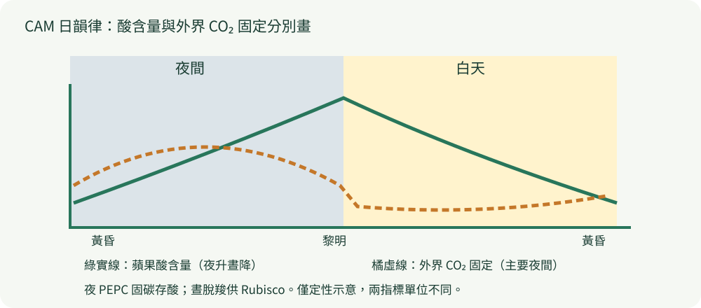

# 101 年花卉學｜逐題教學詳解

共 8 大題，小題合併於各大題。先理解原理，再練寫答案。配分重點為建議架構，不代表官方閱卷細則。

## 第一題｜洋桔梗英文翻譯（10 分）

### 題意與作答範圍

本題重點：**洋桔梗英文翻譯**。下列依題目主題整理答案；題幹、選項與圖表請對照[原始試卷](../../541491416.pdf#page=17)。

### 先掌握答案

這是一題全文翻譯，應保留原文的研究對象、因果、比較、數量與限制。下列譯文按意思分段，術語解析另列。

### 完整參考譯文

洋桔梗（Eustoma grandiflorum）於 1968 年首次引入臺灣，埔里業者曾栽作切花；

但因當時有許多尚未釐清的栽培難題而未成功。細小種子在穴盤發芽不均、幼苗簇生等障礙，經研究者努力獲得解決。中臺灣彰化、雲林及嘉義等縣生產了臺灣多數洋桔梗切花。依日本主要種子販售業者瀧井種苗的報告，臺灣在 2008 年向日本輸出 260 萬枝，約占日本當年進口總量 320 萬枝的 81%。

### 讀懂這段研究在說什麼

**引入、栽培瓶頸與產業化的歷史順序**

1968 年引入、早期栽培不成功、研究克服細種子與簇生障礙，再到產業發展，是連續的歷史因果。應把 rosetting 譯為節間縮短的簇生或蓮座化，不是單純葉片變多；埔里是文中的早期地點，不代表所有時期唯一產區。

### 配分重點與檢查順序

10 分：引進年份地點、難題、主產區、260／320 萬及 81% 均保留。

先檢查是否漏譯整句，再核對否定詞、比較對象、百分比和溫度。研究原文中的「可能」「顯著」「潛力」不可任意改成保證效果；譯文如提到健康或產業效益，應保留為原文陳述，不擴寫成額外建議。

### 常見失分

- 把專業名詞按一般字義翻譯，或把相關性改成因果。
- 省略轉折、條件或限制，使研究結論比原文更強。
- 以摘要取代全文翻譯。

## 第二題｜冬季外銷切花與理由（15 分）

### 題意與作答範圍

本題重點：**冬季外銷切花與理由**。下列依題目主題整理答案；題幹、選項與圖表請對照[原始試卷](../../541491416.pdf#page=17)。

### 先掌握答案

可舉洋桔梗、菊花、文心蘭（依品種供期）或火鶴等，需依題目排除蘭花後選洋桔梗、菊花、火鶴。臺灣中南部冬季較乾暖、日照佳，生產成本與品質相對溫帶冬季加溫栽培有利，又可配日本節慶需求；

### 原理拆解：為什麼會這樣？

**設施先改變能量與物質交換**

覆蓋材料改變光量、光質、輻射與通風；避雨可降低葉面濕潤與部分病害，卻可能增加熱與濕度。說明設施效益時須指出控制的是哪項環境因子，以及該因子如何影響生長或商品品質。

**各因子必須一起管理**

增加光照而不供水可能加劇失水，提高 CO₂ 而遇高溫或低光也難充分增產。通風可以降溫除濕，但會流失補充 CO₂；遮陰可降輻射熱，也會減少光合。設備選擇是對限制因子與成本的整體調整。

**控制成效要用植株與環境資料驗證**

以葉溫、根域溫度、濕度、光量及品質記錄調整設定；空氣溫度不等於葉片溫度。病蟲隔離、結露管理與根域衛生仍須另行建立，不能以設施覆蓋代替全部栽培管理。

**切離後的水分與碳收支轉為赤字**

採後失去根系供水，葉片與花器卻仍蒸散和呼吸。氣栓、切口微生物與導管阻塞會降低吸水；碳源不足則使花蕾開放不良。保鮮須同時處理失水、輸水受阻與能量消耗。

**不同處理各有明確功能**

潔淨用水、切口更新與適當酸化有助輸水；糖供呼吸與開花，抑菌成分降低污染，抗乙烯處理只對適當敏感材料有用。高糖若缺乏衛生控制，可能促進微生物，並非加糖越多越好。

**採收成熟度與溫度決定後續品質上限**

過早採收雖便運輸，花蕾卻可能缺乏開放能力；過晚採則失去貯運時間。盡速移除田間熱，使用該花卉可耐的低溫並避免凝結水；熱帶花材須防寒害，不宜所有花都用同一冷藏設定。

### 可直接練寫的完整答案

可舉洋桔梗、菊花、文心蘭（依品種供期）或火鶴等，需依題目排除蘭花後選洋桔梗、菊花、火鶴。臺灣中南部冬季較乾暖、日照佳，生產成本與品質相對溫帶冬季加溫栽培有利，又可配日本節慶需求；

供貨仍需規格、冷鏈、病蟲及穩定排程。

覆蓋材料改變光量、光質、輻射與通風；避雨可降低葉面濕潤與部分病害，卻可能增加熱與濕度。說明設施效益時須指出控制的是哪項環境因子，以及該因子如何影響生長或商品品質。

增加光照而不供水可能加劇失水，提高 CO₂ 而遇高溫或低光也難充分增產。通風可以降溫除濕，但會流失補充 CO₂；遮陰可降輻射熱，也會減少光合。設備選擇是對限制因子與成本的整體調整。

### 實例：把原理用在情境中

臺灣夏季溫室若僅關閉側窗，可能因通風不足而升溫；可依外氣濕度與作物耐熱性搭配遮陰、通風及蒸發冷卻，再用葉溫與成品品質確認效果。

百合可在適當顯色蕾期採收，搭配補水、潔淨與品種適用的保鮮處理；若蕾太幼小，即使瓶插液含糖，也未必恢復正常花朵大小與開放率。

### 配分重點：哪些內容不能漏？

15 分：至少三非蘭切花、氣候與成本、需求及供應品質。

- **至少三非蘭切花**
- **氣候與成本**
- **需求及供應品質**

細項為依題意整理的建議得分內容，並非校方公布的評分細則。作答時依原題小題順序，讓定義、機制、實例與管理措施互相對應。

### 常見錯誤與修正

- 將溫室直接等同低溫環境。
- 把短時高濃度預措液與全程瓶插液視為相同用法。

## 第三題｜CAM 日韻律圖（10 分）

### 題意與作答範圍

本題重點：**CAM 日韻律圖**。下列依題目主題整理答案；題幹、選項與圖表請對照[原始試卷](../../541491416.pdf#page=17)。

### 先掌握答案

橫軸時間標示夜／晝，夜間氣孔開、PEPC 固定 CO₂ 成草醯乙酸再轉蘋果酸存液泡，因此夜間外界 CO₂ 固定率與蘋果酸淨合成較高；

### 原理拆解：為什麼會這樣？

**夜間固定與白天利用在時間上分開**

典型 CAM 植物夜間較易開氣孔，由 PEPC 將 CO₂ 固定為有機酸並貯存於液泡；白天多關閉氣孔，有機酸脫羧提供 CO₂，供卡爾文循環利用。並不是白天完全不進行光合作用。

**圖要同時畫氣孔與酸度**

典型日韻律為夜間酸度上升、清晨偏高，白天去酸、傍晚偏低；外界 CO₂ 淨吸收主要在夜間。實際常有清晨、傍晚過渡階段，乾旱或發育條件也可能改變曲線。

**分類與灌溉要承認物種差異**

C₃、C₄ 與 CAM 不是依葉片厚薄就能判定，兼性 CAM 會依環境調整。蘭科包含不同固碳途徑，不能把所有蘭都列 CAM；耐旱也不代表高產時不需供水或根部可以長期缺氧。

### 可直接練寫的完整答案

橫軸時間標示夜／晝，夜間氣孔開、PEPC 固定 CO₂ 成草醯乙酸再轉蘋果酸存液泡，因此夜間外界 CO₂ 固定率與蘋果酸淨合成較高；

黎明後蘋果酸含量達高點，白天脫羧供 Rubisco，蘋果酸逐降。酸含量曲線夜升晝降，合成速率則夜正晝負／低，兩者圖不能混用。可補黎明與傍晚 C3 型直接固碳階段依環境改變。

典型 CAM 植物夜間較易開氣孔，由 PEPC 將 CO₂ 固定為有機酸並貯存於液泡；白天多關閉氣孔，有機酸脫羧提供 CO₂，供卡爾文循環利用。並不是白天完全不進行光合作用。

典型日韻律為夜間酸度上升、清晨偏高，白天去酸、傍晚偏低；外界 CO₂ 淨吸收主要在夜間。實際常有清晨、傍晚過渡階段，乾旱或發育條件也可能改變曲線。

### 圖解輔助

示意圖用來理解結構與方向；考場仍須依原題標示軸名、箭頭或構造。

### 實例：把原理用在情境中

蝴蝶蘭常以 CAM 說明節水特性，文心蘭許多栽培材料則以 C₃ 為主；若題目只給「石斛」而未指定物種，應說明屬內差異，避免過度概括。

### 配分重點：哪些內容不能漏？

10 分：標軸、夜固碳、酸合成與含量差別、晝脫羧。

- **夜固碳**
- **酸合成與含量差別**
- **晝脫羧**

細項為依題意整理的建議得分內容，並非校方公布的評分細則。作答時依原題小題順序，讓定義、機制、實例與管理措施互相對應。

### 常見錯誤與修正

- 把 CAM 寫成夜間利用光能進行全部光反應。

## 第四題｜可塑性與全能性、體細胞胚（15 分）

### 題意與作答範圍

本題重點：**可塑性與全能性、體細胞胚**。下列依題目主題整理答案；題幹、選項與圖表請對照[原始試卷](../../541491416.pdf#page=17)。

### 先掌握答案

全能性指適當條件下單一植物細胞能再生成完整植株的潛力；

### 原理拆解：為什麼會這樣？

**先決定繁殖要保留什麼**

有性繁殖經減數分裂與受精，後代可能分離；無性繁殖主要保留母株基因型，適合維持優良栽培品種，但不能因此保證無病毒。選方法時須同時考慮繁殖倍率、遺傳整齊度、母株健康與成本。

**器官形成依靠細胞能力與環境**

扦插須由適合的細胞形成不定根；插穗的成熟度、碳水化合物與內生激素影響能力。生長素可促根原基形成，但過量可能抑制根伸長或造成傷害；並非所有難發根材料都可用提高濃度解決。

**生根前後的管理目標不同**

未生根時以降低葉片失水、保持基部供氧為主；生根後逐漸降低濕度並增加光照，使根系與氣孔功能適應外界。全程積水雖濕度高，卻會降低氧氣、增加腐敗；發根率也應與成苗率分開評估。

### 可直接練寫的完整答案

全能性指適當條件下單一植物細胞能再生成完整植株的潛力；

可塑性指細胞可依訊號改變發育命運。外植體經生長調節劑與營養誘導，部分體細胞取得胚性，形成具根端與芽端的雙極性胚，再發育為苗；

可直接或經癒傷組織間接形成，不是每一細胞在任意培養基都能成胚。

有性繁殖經減數分裂與受精，後代可能分離；無性繁殖主要保留母株基因型，適合維持優良栽培品種，但不能因此保證無病毒。選方法時須同時考慮繁殖倍率、遺傳整齊度、母株健康與成本。

扦插須由適合的細胞形成不定根；插穗的成熟度、碳水化合物與內生激素影響能力。生長素可促根原基形成，但過量可能抑制根伸長或造成傷害；並非所有難發根材料都可用提高濃度解決。

### 實例：把原理用在情境中

玫瑰插穗在間歇噴霧下可減少萎凋，但仍須用排水良好的介質；移出苗床前逐步馴化，才不會把「已發根」誤當成「可直接定植」。

### 配分重點：哪些內容不能漏？

15 分：兩概念、誘導、雙極性與直接／間接路徑、限制。

- **兩概念**
- **雙極性與直接／間接路徑**
- **限制**

細項為依題意整理的建議得分內容，並非校方公布的評分細則。作答時依原題小題順序，讓定義、機制、實例與管理措施互相對應。

### 常見錯誤與修正

- 把無性繁殖與無病毒畫上等號。

## 第五題｜火鶴輸日關鍵（10 分）

### 題意與作答範圍

本題重點：**火鶴輸日關鍵**。下列依題目主題整理答案；題幹、選項與圖表請對照[原始試卷](../../541491416.pdf#page=17)。

### 先掌握答案

田間重視健康苗、細菌性病害與葉斑管理、遮蔭及花莖規格；

### 原理拆解：為什麼會這樣？

**切離後的水分與碳收支轉為赤字**

採後失去根系供水，葉片與花器卻仍蒸散和呼吸。氣栓、切口微生物與導管阻塞會降低吸水；碳源不足則使花蕾開放不良。保鮮須同時處理失水、輸水受阻與能量消耗。

**不同處理各有明確功能**

潔淨用水、切口更新與適當酸化有助輸水；糖供呼吸與開花，抑菌成分降低污染，抗乙烯處理只對適當敏感材料有用。高糖若缺乏衛生控制，可能促進微生物，並非加糖越多越好。

**採收成熟度與溫度決定後續品質上限**

過早採收雖便運輸，花蕾卻可能缺乏開放能力；過晚採則失去貯運時間。盡速移除田間熱，使用該花卉可耐的低溫並避免凝結水；熱帶花材須防寒害，不宜所有花都用同一冷藏設定。

**為何採後仍會變差**

離開母株的果蔬仍是活組織，會呼吸消耗糖與有機酸，蒸散造成失水，部分產品也會產生或回應乙烯。產品不再得到母株穩定供應，原有貯藏物和水分逐步減少，因此採後處理的功能主要是延緩損耗，不能把原先不合格果恢復成高品質。

**低溫有效，但有適用範圍**

降低溫度通常減慢呼吸、衰老與病原生長；然而熱帶產品若低於其安全溫度而放置過久，膜與代謝會受損，出現凹陷、褐化、後熟異常等寒害。寒害可在回溫後才明顯，與組織結冰的凍害不同。

**把全程串起來**

採收成熟度、預冷、包裝、冷庫、運輸、通關和貨架期必須一起設計。高相對濕度可減少失水，但表面凝水會增加腐敗；包裝保濕也必須讓產品有足夠氣體交換。混櫃還需檢查溫度、濕度、乙烯敏感性與最長耐運時間是否相容。

### 可直接練寫的完整答案

田間重視健康苗、細菌性病害與葉斑管理、遮蔭及花莖規格；

採收成熟肉穗與佛焰苞適期，輕採、補水、潔淨保鮮、固定肉穗防碰傷，採不致寒害的適溫運輸。配合檢疫、殘留與規格分級，改善品種單一、品質不齊和物流時效，不能用低溫越低越好的切花通則。

採後失去根系供水，葉片與花器卻仍蒸散和呼吸。氣栓、切口微生物與導管阻塞會降低吸水；碳源不足則使花蕾開放不良。保鮮須同時處理失水、輸水受阻與能量消耗。

潔淨用水、切口更新與適當酸化有助輸水；糖供呼吸與開花，抑菌成分降低污染，抗乙烯處理只對適當敏感材料有用。高糖若缺乏衛生控制，可能促進微生物，並非加糖越多越好。

### 實例：把原理用在情境中

百合可在適當顯色蕾期採收，搭配補水、潔淨與品種適用的保鮮處理；若蕾太幼小，即使瓶插液含糖，也未必恢復正常花朵大小與開放率。

驗證海運方案時，應模擬「船期＋通關＋到貨販售」，到貨後再觀察能否正常後熟、是否產生異味與腐敗。只證明冷庫內外觀正常，不能證明到市場仍有商品價值。

### 配分重點：哪些內容不能漏？

10 分：生產規格、病害、採後防傷防寒、外銷制度。

- **生產規格**
- **採後防傷防寒**
- **外銷制度**

細項為依題意整理的建議得分內容，並非校方公布的評分細則。作答時依原題小題順序，讓定義、機制、實例與管理措施互相對應。

### 常見錯誤與修正

- 把短時高濃度預措液與全程瓶插液視為相同用法。
- 認為溫度越低、保存效果一定越好。

## 第六題｜文心蘭生產與產品處理（15 分）

### 題意與作答範圍

本題重點：**文心蘭生產與產品處理**。下列依題目主題整理答案；題幹、選項與圖表請對照[原始試卷](../../541491416.pdf#page=17)。

### 先掌握答案

建立健康優良母本與一致組培苗，調成熟假球莖、光水肥及花期，支撐花梗、防花斑與蟎。採收以品種適當開花比例，避免幼蕾過多不能開，立即補水、清潔分級與緩衝包裝，維持不傷寒的適溫冷鏈並縮短物流。針對失水、落花、糖不足與病害分別驗證保鮮措施。

### 原理拆解：為什麼會這樣？

**切離後的水分與碳收支轉為赤字**

採後失去根系供水，葉片與花器卻仍蒸散和呼吸。氣栓、切口微生物與導管阻塞會降低吸水；碳源不足則使花蕾開放不良。保鮮須同時處理失水、輸水受阻與能量消耗。

**不同處理各有明確功能**

潔淨用水、切口更新與適當酸化有助輸水；糖供呼吸與開花，抑菌成分降低污染，抗乙烯處理只對適當敏感材料有用。高糖若缺乏衛生控制，可能促進微生物，並非加糖越多越好。

**採收成熟度與溫度決定後續品質上限**

過早採收雖便運輸，花蕾卻可能缺乏開放能力；過晚採則失去貯運時間。盡速移除田間熱，使用該花卉可耐的低溫並避免凝結水；熱帶花材須防寒害，不宜所有花都用同一冷藏設定。

**健康與整齊度要從母本或種子源開始**

母株帶病、種子混雜或發芽不整齊，往往無法只靠後段管理補救。應先選品種與合格種源，建立隔離、檢測與批次追溯；外觀正常並不保證無系統性病毒。

**育苗目標是可定植且恢復快**

適度根系、適當苗齡、均衡地上部與根部，以及無重大病蟲是核心。過度氮肥使苗大且柔嫩，可能反而提高失水與病害；根滿盆、盤根或苗齡過老也會限制定植後生長。

**無菌培養後仍有馴化關卡**

瓶內高濕、低光與外加糖可使幼苗角質層、氣孔及根功能與田間不同。出瓶須逐步調整光濕條件並防感染。組培倍率、出瓶存活率與成品率應分開計算，不能只用增殖數宣稱生產效率。

### 可直接練寫的完整答案

建立健康優良母本與一致組培苗，調成熟假球莖、光水肥及花期，支撐花梗、防花斑與蟎。採收以品種適當開花比例，避免幼蕾過多不能開，立即補水、清潔分級與緩衝包裝，維持不傷寒的適溫冷鏈並縮短物流。針對失水、落花、糖不足與病害分別驗證保鮮措施。

採後失去根系供水，葉片與花器卻仍蒸散和呼吸。氣栓、切口微生物與導管阻塞會降低吸水；碳源不足則使花蕾開放不良。保鮮須同時處理失水、輸水受阻與能量消耗。

潔淨用水、切口更新與適當酸化有助輸水；糖供呼吸與開花，抑菌成分降低污染，抗乙烯處理只對適當敏感材料有用。高糖若缺乏衛生控制，可能促進微生物，並非加糖越多越好。

### 實例：把原理用在情境中

百合可在適當顯色蕾期採收，搭配補水、潔淨與品種適用的保鮮處理；若蕾太幼小，即使瓶插液含糖，也未必恢復正常花朵大小與開放率。

蝴蝶蘭分生苗可用組織培養大量增殖，但需檢測母株病毒並控制培養代數；出瓶後先馴化，再依葉片與根系生長分級，不宜把瓶苗數直接當成上市盆花數。

### 配分重點：哪些內容不能漏？

15 分：田間、成熟度、採後瓶頸及措施，具文心蘭特性。

- **成熟度**
- **採後瓶頸及措施，具文心蘭特性**

細項為依題意整理的建議得分內容，並非校方公布的評分細則。作答時依原題小題順序，讓定義、機制、實例與管理措施互相對應。

### 常見錯誤與修正

- 把短時高濃度預措液與全程瓶插液視為相同用法。
- 將組織培養視為自動消除所有病原。

## 第七題｜15 種光週期分類（15 分）

### 題意與作答範圍

本題重點：**15 種光週期分類**。下列依題目主題整理答案；題幹、選項與圖表請對照[原始試卷](../../541491416.pdf#page=17)。

### 先掌握答案

玫瑰多日中性；

洋桔梗量性長日；

落地生根短日；

夏菊為高溫長日下也能開花的菊花群，臨界日長依品種；

蝴蝶蘭主要溫度誘導、通常日中性；

雞冠花多量性短日；

翠菊多量性長日；

宿根滿天星長日；

聖誕紅短日；

長壽花短日；

金魚草量性長日；

香石竹量性長日；

秋菊短日；

百合依群多量性長日或需冷與日長配合；

火鶴多日中性。

### 原理拆解：為什麼會這樣？

**感應的是日夜節律，常以夜長最關鍵**

短日植物通常需足夠長且連續的黑暗期，長日植物則在適當日長或短夜下促花；日中性不代表完全不受光量影響。須區分絕對與相對反應，以及品種、葉齡與溫度造成的差異。

**感光與光合作用不是同一需求**

暗期中斷以低強度照光便可能改變光週期訊號；補光增加每日光積量，主要補足同化需求。兩者目的、光強與操作時間不同，不能用「照燈會增產」取代成花機制。

**產期調節須兼顧可感應階段**

植株須具適當生理年齡，才能有效接受成花訊號。先在營養生長階段建立株型，再用遮光短日或夜間照光調整成花；花芽形成後仍受溫度與碳供應影響，處理日數不可跨品種硬套。

### 可直接練寫的完整答案

玫瑰多日中性；

洋桔梗量性長日；

落地生根短日；

夏菊為高溫長日下也能開花的菊花群，臨界日長依品種；

蝴蝶蘭主要溫度誘導、通常日中性；

雞冠花多量性短日；

翠菊多量性長日；

宿根滿天星長日；

聖誕紅短日；

長壽花短日；

金魚草量性長日；

香石竹量性長日；

秋菊短日；

百合依群多量性長日或需冷與日長配合；

火鶴多日中性。

短日植物通常需足夠長且連續的黑暗期，長日植物則在適當日長或短夜下促花；日中性不代表完全不受光量影響。須區分絕對與相對反應，以及品種、葉齡與溫度造成的差異。

### 實例：把原理用在情境中

菊花可先用夜間照光延長營養生長、累積足夠莖長，達規格後停止照光並提供適宜短日，使花期配合市場。單靠弱光夜照不足以補足低日照下的生長能量。

### 配分重點：哪些內容不能漏？

15 分：各約 1 分，夏菊、百合保留品種差異，勿強套絕對性。

- **各約 1 分，夏菊**
- **百合保留品種差異，勿強套絕對性**

細項為依題意整理的建議得分內容，並非校方公布的評分細則。作答時依原題小題順序，讓定義、機制、實例與管理措施互相對應。

### 常見錯誤與修正

- 把短日反應簡化為光越少花越多。
- 只抄中文名稱，漏掉題目要求的構造、英文、例子或區別。

## 第八題｜十種主要繁殖法（10 分）

### 題意與作答範圍

本題重點：**十種主要繁殖法**。下列依題目主題整理答案；題幹、選項與圖表請對照[原始試卷](../../541491416.pdf#page=17)。

### 先掌握答案

洋桔梗播種；

### 原理拆解：為什麼會這樣？

**先決定繁殖要保留什麼**

有性繁殖經減數分裂與受精，後代可能分離；無性繁殖主要保留母株基因型，適合維持優良栽培品種，但不能因此保證無病毒。選方法時須同時考慮繁殖倍率、遺傳整齊度、母株健康與成本。

**器官形成依靠細胞能力與環境**

扦插須由適合的細胞形成不定根；插穗的成熟度、碳水化合物與內生激素影響能力。生長素可促根原基形成，但過量可能抑制根伸長或造成傷害；並非所有難發根材料都可用提高濃度解決。

**生根前後的管理目標不同**

未生根時以降低葉片失水、保持基部供氧為主；生根後逐漸降低濕度並增加光照，使根系與氣孔功能適應外界。全程積水雖濕度高，卻會降低氧氣、增加腐敗；發根率也應與成苗率分開評估。

### 可直接練寫的完整答案

洋桔梗播種；

玫瑰扦插（部分生產用嫁接）；

唐菖蒲球莖／子球莖；

非洲菊組培；

聖誕紅扦插；

菊花扦插；

火鶴花組培；

天堂鳥分株（大批苗亦可播種）；

晚香玉分球；

仙客來播種。按「經濟大量栽培主要方式」各選一法，不是列所有可行方法。

有性繁殖經減數分裂與受精，後代可能分離；無性繁殖主要保留母株基因型，適合維持優良栽培品種，但不能因此保證無病毒。選方法時須同時考慮繁殖倍率、遺傳整齊度、母株健康與成本。

扦插須由適合的細胞形成不定根；插穗的成熟度、碳水化合物與內生激素影響能力。生長素可促根原基形成，但過量可能抑制根伸長或造成傷害；並非所有難發根材料都可用提高濃度解決。

### 實例：把原理用在情境中

玫瑰插穗在間歇噴霧下可減少萎凋，但仍須用排水良好的介質；移出苗床前逐步馴化，才不會把「已發根」誤當成「可直接定植」。

### 配分重點：哪些內容不能漏？

10 分：十作物各 1 分，對應主流種苗法。

細項為依題意整理的建議得分內容，並非校方公布的評分細則。作答時依原題小題順序，讓定義、機制、實例與管理措施互相對應。

### 常見錯誤與修正

- 把無性繁殖與無病毒畫上等號。
