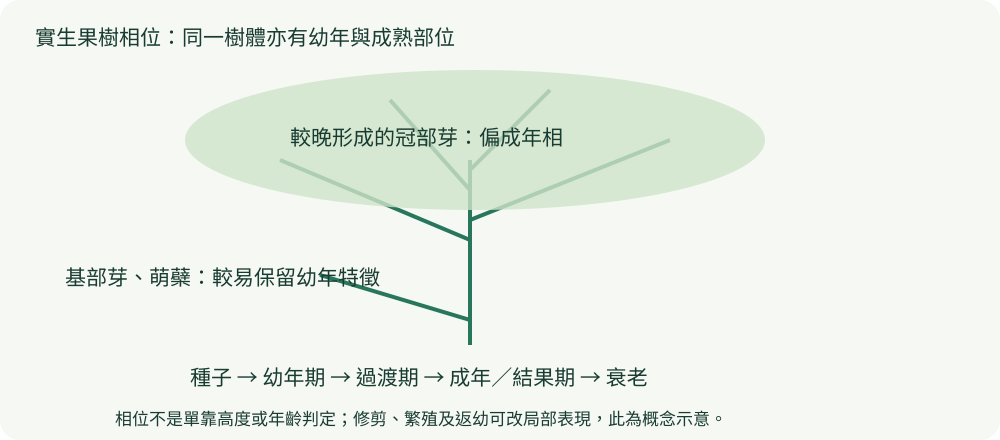

# 103 年果樹學｜逐題教學詳解

共 6 大題，小題合併於各大題。先理解原理，再練寫答案。配分重點為建議架構，不代表官方閱卷細則。

## 第一題｜五果實食用組織（15 分）

### 題意與作答範圍

本題重點：**五果實食用組織**。下列依題目主題整理答案；題幹、選項與圖表請對照[原始試卷](../../541491416.pdf#page=10)。

### 先掌握答案

枇杷主要為花托／花筒等附屬組織形成的肉質部；

櫻桃為中果皮；

無花果主要為肉質隱頭花序托及內部小果組織；

榴槤為種子外的肉質假種皮；

甜橙為內果皮表皮細胞發育的汁囊。應辨清果皮、種皮及花序組織。

### 原理拆解：為什麼會這樣？

**器官來源比外觀名稱更可靠**

地下、肥大或肉質都不能單獨決定是根、莖或葉。莖常有節、節間與芽，根有根冠與根系構造，葉則依附於莖節；判讀食用或觀賞部位時，應由發育來源辨識。

**不同分類軸不能混用**

花序型依花的著生與主軸生長方式分類；果實型則看一花或多花、單個或多個子房以及附屬組織。兩性花與完全花也不同：前者具雄雌蕊，後者還須具萼與瓣。

**名稱與例子要一對一**

寫出構造後立即給正確例子，必要時補充品種或教材口徑。同俗名可能指不同植物，新舊分類也可能用不同科名；可並列通行新名與舊名，避免用俗名差異冒充生物構造差異。

### 可直接練寫的完整答案

枇杷主要為花托／花筒等附屬組織形成的肉質部；

櫻桃為中果皮；

無花果主要為肉質隱頭花序托及內部小果組織；

榴槤為種子外的肉質假種皮；

甜橙為內果皮表皮細胞發育的汁囊。應辨清果皮、種皮及花序組織。

地下、肥大或肉質都不能單獨決定是根、莖或葉。莖常有節、節間與芽，根有根冠與根系構造，葉則依附於莖節；判讀食用或觀賞部位時，應由發育來源辨識。

### 實例：把原理用在情境中

馬鈴薯雖在地下，薯塊有芽眼，屬莖塊莖；甘藷的肥大貯藏器官屬塊根。兩者都儲藏澱粉，不能因此判為相同器官。

### 配分重點：哪些內容不能漏？

15 分：各 3 分，中文果名與正確組織。

細項為依題意整理的建議得分內容，並非校方公布的評分細則。作答時依原題小題順序，讓定義、機制、實例與管理措施互相對應。

### 常見錯誤與修正

- 看到地下器官就全部寫成根。
- 只抄中文名稱，漏掉題目要求的構造、英文、例子或區別。

## 第二題｜庫強（10 分）

### 題意與作答範圍

本題重點：**庫強**。下列依題目主題整理答案；題幹、選項與圖表請對照[原始試卷](../../541491416.pdf#page=10)。

### 先掌握答案

庫強表示器官競爭、輸入與利用同化物的能力，可概念化為庫大小×單位組織活性。果實細胞數、膨大、糖運輸與裂解活性、種子及激素訊號共同決定；

### 原理拆解：為什麼會這樣？

**先把源與庫接起來**

成熟葉通常是淨輸出同化物的源，果實、幼芽及根等是利用或貯藏同化物的庫。糖由葉肉到小葉脈，經伴細胞—篩管裝載，沿葉柄、枝幹與果梗韌皮部運輸，到果實卸載再由果肉利用或存入液泡。

**壓力流與跨膜運輸不是同一層次**

源端糖裝載降低水勢，吸水建立較高膨壓；庫端卸糖降低壓力，形成長距離質流。共質體路徑走胞間連絲，質外體路徑需糖跨膜轉運；H⁺-ATPase 建立電化學梯度，可支援 H⁺／蔗糖共運輸。

**庫強決定競爭，不只看果實大小**

庫強可概念化為庫大小乘單位活性，受細胞數、膨大、種子激素、維管連結及糖分解貯藏能力影響。其他果實與新梢亦競爭同化物；疏果能增加單果分配，但過度疏果降低總收量，需在品質與產量間取捨。

### 可直接練寫的完整答案

庫強表示器官競爭、輸入與利用同化物的能力，可概念化為庫大小×單位組織活性。果實細胞數、膨大、糖運輸與裂解活性、種子及激素訊號共同決定；

距離、維管束連結與其他庫競爭亦影響實際分配。

成熟葉通常是淨輸出同化物的源，果實、幼芽及根等是利用或貯藏同化物的庫。糖由葉肉到小葉脈，經伴細胞—篩管裝載，沿葉柄、枝幹與果梗韌皮部運輸，到果實卸載再由果肉利用或存入液泡。

源端糖裝載降低水勢，吸水建立較高膨壓；庫端卸糖降低壓力，形成長距離質流。共質體路徑走胞間連絲，質外體路徑需糖跨膜轉運；H⁺-ATPase 建立電化學梯度，可支援 H⁺／蔗糖共運輸。

### 實例：把原理用在情境中

同一樹上果實負載增加，若健康受光葉量不變，單果可分得的碳可能下降。這能解釋為何保葉、疏果與控制徒長枝，常比單獨追加「甜果肥」更重要。

### 配分重點：哪些內容不能漏？

10 分：定義、大小與活性、種子激素、競爭及果實例。

- **大小與活性**
- **種子激素**
- **競爭及果實例**

細項為依題意整理的建議得分內容，並非校方公布的評分細則。作答時依原題小題順序，讓定義、機制、實例與管理措施互相對應。

### 常見錯誤與修正

- 把長距離糖運輸寫成主要沿木質部。

## 第三題｜果樹生活史與實生樹相位（25 分）

### 題意與作答範圍

本題重點：**果樹生活史與實生樹相位**。下列依題目主題整理答案；題幹、選項與圖表請對照[原始試卷](../../541491416.pdf#page=10)。

### 先掌握答案

圖示可寫：種子→幼年營養期→過渡期→成年可成花期→盛果期→衰老期。幼年期即使有適宜成花環境也難開花，成年後營養生長與生殖生長可並存。同一實生樹有相位梯度：基部及早期形成枝條保留較幼年特徵，上部較晚形成芽較成熟；

### 原理拆解：為什麼會這樣？

**幼年相與成年相不是樹齡的同義詞**

實生樹由幼年相轉為過渡相、成年相，獲得穩定成花能力。幼年葉形、刺、枝條方向或發根能力可能不同；營養生長旺盛不等於已成年。取成年優良樹接穗可縮短新樹等待開花的時間，但砧木幼齡不表示接穗一定退回完整幼年狀態。修剪位置與材料來源因此會影響繁殖和成花。

**個體年齡與器官相位分開**

實生果樹經幼年相到成年相才獲得充分成花能力，幼年長短受物種與環境影響。樹長得高或枝葉很多不代表已具生殖能力。

**相位改變會表現在多項性狀**

葉形、刺、枝條角度、節間、不定根形成及成花傾向都可能隨相位改變。應用可觀察性狀比較，避免僅寫「幼樹不開花」而沒有生理與形態內容。

**繁殖材料可保留部分成年特性**

成年接穗可較早結果，自根扦插材料的發根能力則可能隨成熟而下降；組培或特殊處理有時可促返幼，但不能保證所有性狀完全重設。多年生育種需因此安排足夠觀察時間。

### 可直接練寫的完整答案

圖示可寫：種子→幼年營養期→過渡期→成年可成花期→盛果期→衰老期。幼年期即使有適宜成花環境也難開花，成年後營養生長與生殖生長可並存。同一實生樹有相位梯度：基部及早期形成枝條保留較幼年特徵，上部較晚形成芽較成熟；

但局部返幼或萌蘗使梯度不必完全等同高度。

實生樹由幼年相轉為過渡相、成年相，獲得穩定成花能力。幼年葉形、刺、枝條方向或發根能力可能不同；營養生長旺盛不等於已成年。取成年優良樹接穗可縮短新樹等待開花的時間，但砧木幼齡不表示接穗一定退回完整幼年狀態。修剪位置與材料來源因此會影響繁殖和成花。

### 圖解輔助

示意圖用來理解結構與方向；考場仍須依原題標示軸名、箭頭或構造。

### 實例：把原理用在情境中

選成熟優良果樹的成年枝條嫁接，通常較實生苗早進入開花結果；相同成年枝條卻可能較難扦插發根，顯示繁殖與成花的需求未必一致。

### 配分重點：哪些內容不能漏？

25 分：生活史 15 分需圖與各期特性；同株相位 10 分需基部幼年／頂部成熟及繁殖影響。

- **生活史 15 分需圖與各期特性**
- **同株相位 10 分需基部幼年／頂部成熟及繁殖影響**

細項為依題意整理的建議得分內容，並非校方公布的評分細則。作答時依原題小題順序，讓定義、機制、實例與管理措施互相對應。

### 常見錯誤與修正

- 把修剪後的新梢全視為重新從種子開始的幼年相。

## 第四題｜臺灣果樹外銷優劣（15 分）

### 題意與作答範圍

本題重點：**臺灣果樹外銷優劣**。下列依題目主題整理答案；題幹、選項與圖表請對照[原始試卷](../../541491416.pdf#page=10)。

### 先掌握答案

優勢為熱帶至溫帶多樣產地、優良風味與品種、精細管理及產調、鄰近東亞市場。劣勢為小農成本高、供應規格不一、颱風氣候風險、檢疫與殘留門檻、採後與長途冷鏈不足。策略為共同供貨、契作與分級、研發耐運品種、冷鏈驗證、追溯及多元市場。

### 原理拆解：為什麼會這樣？

**為何採後仍會變差**

離開母株的果蔬仍是活組織，會呼吸消耗糖與有機酸，蒸散造成失水，部分產品也會產生或回應乙烯。產品不再得到母株穩定供應，原有貯藏物和水分逐步減少，因此採後處理的功能主要是延緩損耗，不能把原先不合格果恢復成高品質。

**低溫有效，但有適用範圍**

降低溫度通常減慢呼吸、衰老與病原生長；然而熱帶產品若低於其安全溫度而放置過久，膜與代謝會受損，出現凹陷、褐化、後熟異常等寒害。寒害可在回溫後才明顯，與組織結冰的凍害不同。

**把全程串起來**

採收成熟度、預冷、包裝、冷庫、運輸、通關和貨架期必須一起設計。高相對濕度可減少失水，但表面凝水會增加腐敗；包裝保濕也必須讓產品有足夠氣體交換。混櫃還需檢查溫度、濕度、乙烯敏感性與最長耐運時間是否相容。

**先把育種目標寫成可測量性狀**

抗病、品質、產量與環境適應常同時重要，但選拔方法不同。須先定義病原或逆境、品質指標及目標產區，再選有差異的親本；只說培育優良品種，無法說明如何選拔。

**創造變異與選出穩定材料是兩階段**

雜交、誘變、倍數變化與基因工程提供不同變異來源；後續仍要確認目標性狀、農藝表現、遺傳穩定與不利連帶效應。有性後代會分離，無性增殖可保留選中的個體，但仍須評估體細胞變異。

**田間與商品試驗不能省略**

分子或培養室結果不能代替多環境試驗。應在目標季節與產區比較產量、品質、抗性和栽培成本，必要時再回交去除不良背景。新品系的登錄、繁殖純度與種苗供應也影響實際推廣。

### 可直接練寫的完整答案

優勢為熱帶至溫帶多樣產地、優良風味與品種、精細管理及產調、鄰近東亞市場。劣勢為小農成本高、供應規格不一、颱風氣候風險、檢疫與殘留門檻、採後與長途冷鏈不足。策略為共同供貨、契作與分級、研發耐運品種、冷鏈驗證、追溯及多元市場。

離開母株的果蔬仍是活組織，會呼吸消耗糖與有機酸，蒸散造成失水，部分產品也會產生或回應乙烯。產品不再得到母株穩定供應，原有貯藏物和水分逐步減少，因此採後處理的功能主要是延緩損耗，不能把原先不合格果恢復成高品質。

降低溫度通常減慢呼吸、衰老與病原生長；然而熱帶產品若低於其安全溫度而放置過久，膜與代謝會受損，出現凹陷、褐化、後熟異常等寒害。寒害可在回溫後才明顯，與組織結冰的凍害不同。

### 實例：把原理用在情境中

驗證海運方案時，應模擬「船期＋通關＋到貨販售」，到貨後再觀察能否正常後熟、是否產生異味與腐敗。只證明冷庫內外觀正常，不能證明到市場仍有商品價值。

導入抗病基因後，仍須在接種條件確認抗性，並比較果形、熟期與產量；若抗病供體帶入劣質性狀，可透過回交與選拔恢復商品背景。

### 配分重點：哪些內容不能漏？

15 分：優勢、劣勢各具例，提出對應外銷策略。

細項為依題意整理的建議得分內容，並非校方公布的評分細則。作答時依原題小題順序，讓定義、機制、實例與管理措施互相對應。

### 常見錯誤與修正

- 認為溫度越低、保存效果一定越好。
- 把轉入基因成功直接等同育成可商業化品種。

## 第五題｜紅龍果採後品質因子（10 分）

### 題意與作答範圍

本題重點：**紅龍果採後品質因子**。下列依題目主題整理答案；題幹、選項與圖表請對照[原始試卷](../../541491416.pdf#page=10)。

### 先掌握答案

採收成熟度決定糖酸與風味，非更年性果實不能期待採後大幅增糖；

### 原理拆解：為什麼會這樣？

**為何採後仍會變差**

離開母株的果蔬仍是活組織，會呼吸消耗糖與有機酸，蒸散造成失水，部分產品也會產生或回應乙烯。產品不再得到母株穩定供應，原有貯藏物和水分逐步減少，因此採後處理的功能主要是延緩損耗，不能把原先不合格果恢復成高品質。

**低溫有效，但有適用範圍**

降低溫度通常減慢呼吸、衰老與病原生長；然而熱帶產品若低於其安全溫度而放置過久，膜與代謝會受損，出現凹陷、褐化、後熟異常等寒害。寒害可在回溫後才明顯，與組織結冰的凍害不同。

**把全程串起來**

採收成熟度、預冷、包裝、冷庫、運輸、通關和貨架期必須一起設計。高相對濕度可減少失水，但表面凝水會增加腐敗；包裝保濕也必須讓產品有足夠氣體交換。混櫃還需檢查溫度、濕度、乙烯敏感性與最長耐運時間是否相容。

### 可直接練寫的完整答案

採收成熟度決定糖酸與風味，非更年性果實不能期待採後大幅增糖；

採傷、失水使苞片萎凋、果皮皺縮，過低溫引起寒害，較高溫則呼吸與腐敗加快。應適熟輕採、及時降溫、保濕透氣包裝並避免結露，依品種與運期驗證設定。

離開母株的果蔬仍是活組織，會呼吸消耗糖與有機酸，蒸散造成失水，部分產品也會產生或回應乙烯。產品不再得到母株穩定供應，原有貯藏物和水分逐步減少，因此採後處理的功能主要是延緩損耗，不能把原先不合格果恢復成高品質。

降低溫度通常減慢呼吸、衰老與病原生長；然而熱帶產品若低於其安全溫度而放置過久，膜與代謝會受損，出現凹陷、褐化、後熟異常等寒害。寒害可在回溫後才明顯，與組織結冰的凍害不同。

### 實例：把原理用在情境中

驗證海運方案時，應模擬「船期＋通關＋到貨販售」，到貨後再觀察能否正常後熟、是否產生異味與腐敗。只證明冷庫內外觀正常，不能證明到市場仍有商品價值。

### 配分重點：哪些內容不能漏？

10 分：成熟、失水、傷害、溫度病害及管理。

細項為依題意整理的建議得分內容，並非校方公布的評分細則。作答時依原題小題順序，讓定義、機制、實例與管理措施互相對應。

### 常見錯誤與修正

- 認為溫度越低、保存效果一定越好。

## 第六題｜番木瓜四小題（25 分）

### 題意與作答範圍

本題重點：**番木瓜四小題**。下列依題目主題整理答案；題幹、選項與圖表請對照[原始試卷](../../541491416.pdf#page=10)。

### 先掌握答案

(1)可舉缺硼瘤果、低溫或性別發育失衡引起畸形果，連結微量元素、水分及花期溫度。

### 原理拆解：為什麼會這樣？

**根部問題先分辨物理、化學與生物因子**

積水與壓實造成缺氧，鹽類累積降低水勢，酸鹼失衡改變養分有效性，連作則可能累積特定病原及根系有害物。症狀都可能表現生長慢或萎凋，診斷不能只看地上部。

**處置要對應限制因子**

排水與改良結構處理缺氧；適當灌排與降低過量施肥處理鹽分；輪作、健康苗、清園和衛生處理降低病原。若只增加有機質卻未確認成熟度與含鹽量，可能加重耗氧或鹽害。

**改善後仍須追蹤**

以土壤或介質 EC、pH、根系健康與灌排水品質驗證。淋洗鹽分須有排水出口，輪作須選非共同寄主；單次消毒若之後再引入帶病苗，問題仍可能快速復發。

**發芽率、活力與壽命要分開**

發芽率是在規定適宜條件下形成正常幼苗的比例；活力反映較廣環境下快速、整齊出苗的能力；壽命是維持可用生活力的時間。兩批種子發芽率相近，低溫或逆境下的田間出苗仍可能不同。

**劣化涉及膜與修復能力**

貯藏時氧化與脂質過氧化、膜完整性下降、酵素和核酸損傷會累積，使吸脹滲漏增加、發芽延遲或異常苗增加。單純補肥不能逆轉已嚴重劣化種子的遺傳與細胞損傷。

**保存與檢測依種子特性選擇**

耐乾燥的正貯型種子通常可適度乾燥、低溫與防潮保存；不耐乾燥的種子不能照抄同法。發芽試驗、加速老化、導電度或低溫試驗各反映不同面向，須選適合作物的條件與標準。

### 可直接練寫的完整答案

(1)可舉缺硼瘤果、低溫或性別發育失衡引起畸形果，連結微量元素、水分及花期溫度。

(2)網室阻隔傳毒昆蟲與風害，但有成本、積熱、授粉及網破風險。

(3)根對缺氧敏感，淹水使呼吸與 ATP、吸收下降，厭氧與根腐增加；

高畦排水、避免長期積水並評估砧木或耐性材料。

(4)發芽不齊可與種皮及肉質外種皮抑制物、休眠和種子活力有關；

採熟果種子、去外種皮、洗淨及依品種溫水／適溫催芽，避免高溫傷胚。

積水與壓實造成缺氧，鹽類累積降低水勢，酸鹼失衡改變養分有效性，連作則可能累積特定病原及根系有害物。症狀都可能表現生長慢或萎凋，診斷不能只看地上部。

排水與改良結構處理缺氧；適當灌排與降低過量施肥處理鹽分；輪作、健康苗、清園和衛生處理降低病原。若只增加有機質卻未確認成熟度與含鹽量，可能加重耗氧或鹽害。

### 實例：把原理用在情境中

設施內缺乏雨水淋洗又持續過量施肥時，表土可累積鹽類；應先測 EC 並查灌溉水，再調整肥量與排水淋洗，不能看到萎凋就一律再追肥。

蔥種子貯藏後即使標準發芽率尚可，活力降低也可能使育苗出苗不整；先做活力或小規模出苗比較，比直接增加播種密度更能掌握苗數。

### 配分重點：哪些內容不能漏？

25 分：依原卷 5、5、10、5 分安排，各題原因與改善都寫。

- **依原卷 5**
- **5 分安排，各題原因與改善都寫**

細項為依題意整理的建議得分內容，並非校方公布的評分細則。作答時依原題小題順序，讓定義、機制、實例與管理措施互相對應。

### 常見錯誤與修正

- 將連作障礙全部歸因於缺肥。
- 把所有未發芽種子都判為死亡，漏掉休眠。
