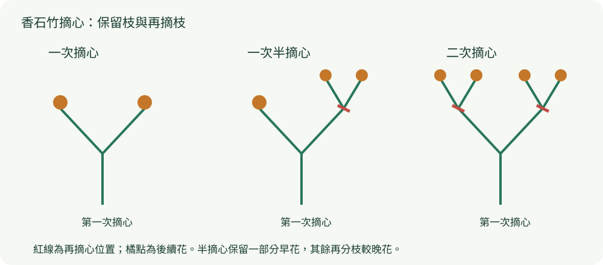

# 104 年花卉學｜逐題教學詳解

共 7 大題，小題合併於各大題。先理解原理，再練寫答案。配分重點為建議架構，不代表官方閱卷細則。

## 第一題｜文心蘭開花與產調（15 分）

### 題意與作答範圍

本題重點：**文心蘭開花與產調**。下列依題目主題整理答案；題幹、選項與圖表請對照[原始試卷](../../541491416.pdf#page=8)。

### 先掌握答案

文心蘭須足夠成熟生長單位、葉面積與碳貯藏，新芽及假球莖發育狀態影響花梗形成；

### 原理拆解：為什麼會這樣？

**先把源與庫接起來**

成熟葉通常是淨輸出同化物的源，果實、幼芽及根等是利用或貯藏同化物的庫。糖由葉肉到小葉脈，經伴細胞—篩管裝載，沿葉柄、枝幹與果梗韌皮部運輸，到果實卸載再由果肉利用或存入液泡。

**壓力流與跨膜運輸不是同一層次**

源端糖裝載降低水勢，吸水建立較高膨壓；庫端卸糖降低壓力，形成長距離質流。共質體路徑走胞間連絲，質外體路徑需糖跨膜轉運；H⁺-ATPase 建立電化學梯度，可支援 H⁺／蔗糖共運輸。

**庫強決定競爭，不只看果實大小**

庫強可概念化為庫大小乘單位活性，受細胞數、膨大、種子激素、維管連結及糖分解貯藏能力影響。其他果實與新梢亦競爭同化物；疏果能增加單果分配，但過度疏果降低總收量，需在品質與產量間取捨。

**設施先改變能量與物質交換**

覆蓋材料改變光量、光質、輻射與通風；避雨可降低葉面濕潤與部分病害，卻可能增加熱與濕度。說明設施效益時須指出控制的是哪項環境因子，以及該因子如何影響生長或商品品質。

**各因子必須一起管理**

增加光照而不供水可能加劇失水，提高 CO₂ 而遇高溫或低光也難充分增產。通風可以降溫除濕，但會流失補充 CO₂；遮陰可降輻射熱，也會減少光合。設備選擇是對限制因子與成本的整體調整。

**控制成效要用植株與環境資料驗證**

以葉溫、根域溫度、濕度、光量及品質記錄調整設定；空氣溫度不等於葉片溫度。病蟲隔離、結露管理與根域衛生仍須另行建立，不能以設施覆蓋代替全部栽培管理。

### 可直接練寫的完整答案

文心蘭須足夠成熟生長單位、葉面積與碳貯藏，新芽及假球莖發育狀態影響花梗形成；

溫度、光量與水肥共同調節。可分批分株／換盆、調新芽數與萌發期，配合不同品種、產區溫度及適量遮光肥水，使成熟假球莖在預定時段抽梗；

不可把它當成所有品種都用短日或低溫即可催花。

成熟葉通常是淨輸出同化物的源，果實、幼芽及根等是利用或貯藏同化物的庫。糖由葉肉到小葉脈，經伴細胞—篩管裝載，沿葉柄、枝幹與果梗韌皮部運輸，到果實卸載再由果肉利用或存入液泡。

源端糖裝載降低水勢，吸水建立較高膨壓；庫端卸糖降低壓力，形成長距離質流。共質體路徑走胞間連絲，質外體路徑需糖跨膜轉運；H⁺-ATPase 建立電化學梯度，可支援 H⁺／蔗糖共運輸。

### 實例：把原理用在情境中

同一樹上果實負載增加，若健康受光葉量不變，單果可分得的碳可能下降。這能解釋為何保葉、疏果與控制徒長枝，常比單獨追加「甜果肥」更重要。

臺灣夏季溫室若僅關閉側窗，可能因通風不足而升溫；可依外氣濕度與作物耐熱性搭配遮陰、通風及蒸發冷卻，再用葉溫與成品品質確認效果。

### 配分重點：哪些內容不能漏？

15 分：生長單位成熟、環境、實際分批方法及品種限制。

- **生長單位成熟**
- **實際分批方法及品種限制**

細項為依題意整理的建議得分內容，並非校方公布的評分細則。作答時依原題小題順序，讓定義、機制、實例與管理措施互相對應。

### 常見錯誤與修正

- 把長距離糖運輸寫成主要沿木質部。
- 將溫室直接等同低溫環境。

## 第二題｜盆花培養土調配（15 分）

### 題意與作答範圍

本題重點：**盆花培養土調配**。下列依題目主題整理答案；題幹、選項與圖表請對照[原始試卷](../../541491416.pdf#page=8)。

### 先掌握答案

依作物根域需求與盆大小，選泥炭／椰纖供水、珍珠石／樹皮供氣，調適當容重與結構，測 pH、EC、保水與空氣孔隙，補適量基肥、必要石灰及微量元素，避免未熟有機質與污染。混拌均勻、批次檢驗，灌溉制度隨配方修正。

### 原理拆解：為什麼會這樣？

**根需要水，也需要氧**

介質總孔隙由充水與充氣孔隙共同構成。細料增加保水未必增加有效供水；若長期飽和，根呼吸受阻，吸收能力反而下降。因此要依盆高、灌溉頻率與根系特性調配，不能單以原料名稱判斷好壞。

**化學性質會改變肥培結果**

pH 影響元素溶解與有效性，EC 反映可溶性鹽類總量，陽離子交換容量影響養分緩衝。高 EC 可能使根吸水困難，即使盆土潮濕也會出現生理乾旱；pH 與 EC 是不同指標，不能相互替代。

**配方應可重複而且衛生**

選擇穩定、無病原與雜草種子、粒徑一致的材料，混合後實測保水、通氣、pH 及 EC。泥炭、椰纖、樹皮等有機材料會分解或吸附養分；珍珠石等材料的作用也受比例與粒徑影響，配方必須搭配灌肥管理。

### 可直接練寫的完整答案

依作物根域需求與盆大小，選泥炭／椰纖供水、珍珠石／樹皮供氣，調適當容重與結構，測 pH、EC、保水與空氣孔隙，補適量基肥、必要石灰及微量元素，避免未熟有機質與污染。混拌均勻、批次檢驗，灌溉制度隨配方修正。

介質總孔隙由充水與充氣孔隙共同構成。細料增加保水未必增加有效供水；若長期飽和，根呼吸受阻，吸收能力反而下降。因此要依盆高、灌溉頻率與根系特性調配，不能單以原料名稱判斷好壞。

pH 影響元素溶解與有效性，EC 反映可溶性鹽類總量，陽離子交換容量影響養分緩衝。高 EC 可能使根吸水困難，即使盆土潮濕也會出現生理乾旱；pH 與 EC 是不同指標，不能相互替代。

### 實例：把原理用在情境中

同一泥炭與珍珠石配方用於矮盆時，底部飽和區占比可能較高；若又照高盆的頻率灌水，根部缺氧風險便增加。應從盆器與水分實測修正，而非只換肥料。

### 配分重點：哪些內容不能漏？

15 分：水氣平衡、材料功能、化性、衛生與驗證。

- **水氣平衡**
- **材料功能**
- **衛生與驗證**

細項為依題意整理的建議得分內容，並非校方公布的評分細則。作答時依原題小題順序，讓定義、機制、實例與管理措施互相對應。

### 常見錯誤與修正

- 把無土介質寫成完全不含有機物。

## 第三題｜香石竹五種異常（15 分）

### 題意與作答範圍

本題重點：**香石竹五種異常**。下列依題目主題整理答案；題幹、選項與圖表請對照[原始試卷](../../541491416.pdf#page=8)。

### 先掌握答案

睡眠病指花瓣內捲、不開或提早萎凋，常與乙烯作用相關；

### 原理拆解：為什麼會這樣？

**症狀先分清，才能討論環境成因**

香石竹裂萼是花瓣或花部生長與萼筒承受力不協調，品種與溫度波動會影響；花器增生等畸形也受花芽發育期溫度及基因型影響。「獅頭花」在不同教材與作物中的用法不一，原卷未附照片時不宜武斷等同單一英文病名。作答宜保留原俗稱，說明判讀依據與可確認的管理機制。

**切離後的水分與碳收支轉為赤字**

採後失去根系供水，葉片與花器卻仍蒸散和呼吸。氣栓、切口微生物與導管阻塞會降低吸水；碳源不足則使花蕾開放不良。保鮮須同時處理失水、輸水受阻與能量消耗。

**不同處理各有明確功能**

潔淨用水、切口更新與適當酸化有助輸水；糖供呼吸與開花，抑菌成分降低污染，抗乙烯處理只對適當敏感材料有用。高糖若缺乏衛生控制，可能促進微生物，並非加糖越多越好。

**採收成熟度與溫度決定後續品質上限**

過早採收雖便運輸，花蕾卻可能缺乏開放能力；過晚採則失去貯運時間。盡速移除田間熱，使用該花卉可耐的低溫並避免凝結水；熱帶花材須防寒害，不宜所有花都用同一冷藏設定。

**設施先改變能量與物質交換**

覆蓋材料改變光量、光質、輻射與通風；避雨可降低葉面濕潤與部分病害，卻可能增加熱與濕度。說明設施效益時須指出控制的是哪項環境因子，以及該因子如何影響生長或商品品質。

**各因子必須一起管理**

增加光照而不供水可能加劇失水，提高 CO₂ 而遇高溫或低光也難充分增產。通風可以降溫除濕，但會流失補充 CO₂；遮陰可降輻射熱，也會減少光合。設備選擇是對限制因子與成本的整體調整。

**控制成效要用植株與環境資料驗證**

以葉溫、根域溫度、濕度、光量及品質記錄調整設定；空氣溫度不等於葉片溫度。病蟲隔離、結露管理與根域衛生仍須另行建立，不能以設施覆蓋代替全部栽培管理。

### 可直接練寫的完整答案

睡眠病指花瓣內捲、不開或提早萎凋，常與乙烯作用相關；

折頸為花下莖段支撐不足，受弱光、高溫、營養及水分失衡影響。牛頭花 bullhead 為異常大型花，常因花蕾快速生長期突然降溫，花內形成額外生長中心、花瓣與花瓣狀組織增加；

獅頭花亦屬異常花形俗稱，可從增瓣、花內芽及花形凌亂判讀，但與牛頭的中文對照仍需依授課圖鑑。裂萼則因花瓣量與萼筒生長不協調、溫度驟變及品種敏感。管理用適溫、均衡水肥、充足光與抗乙烯。

香石竹裂萼是花瓣或花部生長與萼筒承受力不協調，品種與溫度波動會影響；花器增生等畸形也受花芽發育期溫度及基因型影響。「獅頭花」在不同教材與作物中的用法不一，原卷未附照片時不宜武斷等同單一英文病名。作答宜保留原俗稱，說明判讀依據與可確認的管理機制。

### 實例：把原理用在情境中

百合可在適當顯色蕾期採收，搭配補水、潔淨與品種適用的保鮮處理；若蕾太幼小，即使瓶插液含糖，也未必恢復正常花朵大小與開放率。

臺灣夏季溫室若僅關閉側窗，可能因通風不足而升溫；可依外氣濕度與作物耐熱性搭配遮陰、通風及蒸發冷卻，再用葉溫與成品品質確認效果。

### 配分重點：哪些內容不能漏？

15 分：五項各 3 分；睡眠病、折頸、裂萼給機制，牛頭花低溫與額外生長中心，獅頭中文對照另註。

- **五項各 3 分**
- **睡眠病**
- **裂萼給機制，牛頭花低溫與額外生長中心，獅頭中文對照另註**

細項為依題意整理的建議得分內容，並非校方公布的評分細則。作答時依原題小題順序，讓定義、機制、實例與管理措施互相對應。

### 常見錯誤與修正

- 把短時高濃度預措液與全程瓶插液視為相同用法。
- 將溫室直接等同低溫環境。

## 第四題｜臺灣原生百合卻進口種球（15 分）

### 題意與作答範圍

本題重點：**臺灣原生百合卻進口種球**。下列依題目主題整理答案；題幹、選項與圖表請對照[原始試卷](../../541491416.pdf#page=8)。

### 先掌握答案

原生百合不等同市場要求的多樣東方型、亞洲型及種間雜交品種。商業切花需特定花色、花型、莖長、球徑、健康度及一致休眠處理；

### 原理拆解：為什麼會這樣？

**有原生種不代表具有商業種球供應鏈**

原生百合代表育種與生態資源，商業切花所需則是指定品種、周徑分級、健康檢測、低溫處理與穩定供應。種球生產又需多年養球與適合氣候，若本地夏季病害、高溫與成本不利，進口合規種球仍可能較有競爭力。保育原生資源與建立商品種球產業是不同工作。

**鱗莖是當期萌發與下一期生長的貯藏器官**

肉質鱗片葉連在基盤，提供萌芽抽莖初期的資源；隨後新葉光合，再回補新生鱗片與子球。鱗莖不是實心球莖，也不是肥大根。

**種球歷程影響開花整齊度**

品種、球徑、養球成熟度、健康與低溫處理會影響抽芽和花芽發育。採購指定規格種球是成品生產的重要起點；僅知道當地有原生百合，不能推定可直接取代商業種球。

**種球生產與切花採收目標不同**

養球可適期摘蕾減少生殖庫競爭，並保留健康莖葉供碳；切花則須在可正常開放的顯色蕾期採收並注意補水保鮮。切得過低會減少留田葉量，後續球重與再生可能受影響。

**健康與整齊度要從母本或種子源開始**

母株帶病、種子混雜或發芽不整齊，往往無法只靠後段管理補救。應先選品種與合格種源，建立隔離、檢測與批次追溯；外觀正常並不保證無系統性病毒。

**育苗目標是可定植且恢復快**

適度根系、適當苗齡、均衡地上部與根部，以及無重大病蟲是核心。過度氮肥使苗大且柔嫩，可能反而提高失水與病害；根滿盆、盤根或苗齡過老也會限制定植後生長。

**無菌培養後仍有馴化關卡**

瓶內高濕、低光與外加糖可使幼苗角質層、氣孔及根功能與田間不同。出瓶須逐步調整光濕條件並防感染。組培倍率、出瓶存活率與成品率應分開計算，不能只用增殖數宣稱生產效率。

### 可直接練寫的完整答案

原生百合不等同市場要求的多樣東方型、亞洲型及種間雜交品種。商業切花需特定花色、花型、莖長、球徑、健康度及一致休眠處理；

臺灣夏熱、病毒累積與種球養成成本，使冷涼地專業種球產區更具優勢。進口已分級、低溫處理與品種授權的球可穩定排程；

本地仍可發展健康種球與適地育種。

原生百合代表育種與生態資源，商業切花所需則是指定品種、周徑分級、健康檢測、低溫處理與穩定供應。種球生產又需多年養球與適合氣候，若本地夏季病害、高溫與成本不利，進口合規種球仍可能較有競爭力。保育原生資源與建立商品種球產業是不同工作。

### 實例：把原理用在情境中

同一品種若用不同球徑與不同低溫歷程，花枝高度和開花整齊度可能不同；試驗應先固定種球規格，再比較肥水，否則難分辨管理效果。

蝴蝶蘭分生苗可用組織培養大量增殖，但需檢測母株病毒並控制培養代數；出瓶後先馴化，再依葉片與根系生長分級，不宜把瓶苗數直接當成上市盆花數。

### 配分重點：哪些內容不能漏？

15 分：物種與商品品種不同、氣候、健康規格與成本。

- **物種與商品品種不同**
- **健康規格與成本**

細項為依題意整理的建議得分內容，並非校方公布的評分細則。作答時依原題小題順序，讓定義、機制、實例與管理措施互相對應。

### 常見錯誤與修正

- 將百合鱗莖誤寫成唐菖蒲式實心球莖。
- 將組織培養視為自動消除所有病原。

## 第五題｜玫瑰成花與偃枝（15 分）

### 題意與作答範圍

本題重點：**玫瑰成花與偃枝**。下列依題目主題整理答案；題幹、選項與圖表請對照[原始試卷](../../541491416.pdf#page=8)。

### 先掌握答案

現代重複開花玫瑰多在當期新梢頂端成花，修剪後腋芽抽新梢，經足夠葉片與光溫形成花。偃枝將部分枝條彎下保留作同化枝，減頂端優勢、促基部強新梢，維持大量受光葉提供碳源；

### 原理拆解：為什麼會這樣？

**先由當期新梢理解開花**

多數切花玫瑰的花在當期伸長枝頂端形成，採切或修剪後由腋芽再萌生花枝。剪口位置、保留葉量與芽的成熟狀態會影響新枝粗度、長度與採收時間，不能只用長日或短日分類解釋。

**偃枝保留供源，直立花枝作為主要庫**

將部分營養枝彎折，使其減弱頂端優勢與直立競爭，保留葉面積供應同化物；基部或保留芽形成直立採花枝。彎而不折斷維管束、維持葉片受光和健康，是效益成立的條件。

**修剪要同時更新與避免過度減葉**

去病弱、老化與交叉枝可改善通風並促更新；若重剪時去除大量有效葉，短期供碳反而不足。應按品種、市場枝長、採花節奏與季節光量調整，並防彎枝層過密。

### 可直接練寫的完整答案

現代重複開花玫瑰多在當期新梢頂端成花，修剪後腋芽抽新梢，經足夠葉片與光溫形成花。偃枝將部分枝條彎下保留作同化枝，減頂端優勢、促基部強新梢，維持大量受光葉提供碳源；

直立採花枝可取得較粗長花莖。須保葉、控密度，彎折不能傷斷維管束。

多數切花玫瑰的花在當期伸長枝頂端形成，採切或修剪後由腋芽再萌生花枝。剪口位置、保留葉量與芽的成熟狀態會影響新枝粗度、長度與採收時間，不能只用長日或短日分類解釋。

將部分營養枝彎折，使其減弱頂端優勢與直立競爭，保留葉面積供應同化物；基部或保留芽形成直立採花枝。彎而不折斷維管束、維持葉片受光和健康，是效益成立的條件。

### 實例：把原理用在情境中

冬季低光期若仍大幅去除偃枝葉片，後續採花枝可能細弱；維持健康供源層並合理調整採枝數，比只追求萌芽數更能維持合格花枝。

### 配分重點：哪些內容不能漏？

15 分：新梢頂花、萌芽流程、偃枝源庫與強枝原理。

- **新梢頂花**
- **萌芽流程**
- **偃枝源庫與強枝原理**

細項為依題意整理的建議得分內容，並非校方公布的評分細則。作答時依原題小題順序，讓定義、機制、實例與管理措施互相對應。

### 常見錯誤與修正

- 把偃枝當作把供源葉全部剪除。

## 第六題｜設施重要性（15 分）

### 題意與作答範圍

本題重點：**設施重要性**。下列依題目主題整理答案；題幹、選項與圖表請對照[原始試卷](../../541491416.pdf#page=8)。

### 先掌握答案

避免豪雨風害與花瓣污染，控制光溫濕、日長、水肥與病蟲入口，利於切花規格、盆花整齊度及全年排程；

### 原理拆解：為什麼會這樣？

**設施先改變能量與物質交換**

覆蓋材料改變光量、光質、輻射與通風；避雨可降低葉面濕潤與部分病害，卻可能增加熱與濕度。說明設施效益時須指出控制的是哪項環境因子，以及該因子如何影響生長或商品品質。

**各因子必須一起管理**

增加光照而不供水可能加劇失水，提高 CO₂ 而遇高溫或低光也難充分增產。通風可以降溫除濕，但會流失補充 CO₂；遮陰可降輻射熱，也會減少光合。設備選擇是對限制因子與成本的整體調整。

**控制成效要用植株與環境資料驗證**

以葉溫、根域溫度、濕度、光量及品質記錄調整設定；空氣溫度不等於葉片溫度。病蟲隔離、結露管理與根域衛生仍須另行建立，不能以設施覆蓋代替全部栽培管理。

### 可直接練寫的完整答案

避免豪雨風害與花瓣污染，控制光溫濕、日長、水肥與病蟲入口，利於切花規格、盆花整齊度及全年排程；

出口穩定交貨亦仰賴此環境控制。經濟上要以商品率、能源折舊及災損風險評估，而非只比較單位產量。

覆蓋材料改變光量、光質、輻射與通風；避雨可降低葉面濕潤與部分病害，卻可能增加熱與濕度。說明設施效益時須指出控制的是哪項環境因子，以及該因子如何影響生長或商品品質。

增加光照而不供水可能加劇失水，提高 CO₂ 而遇高溫或低光也難充分增產。通風可以降溫除濕，但會流失補充 CO₂；遮陰可降輻射熱，也會減少光合。設備選擇是對限制因子與成本的整體調整。

### 實例：把原理用在情境中

臺灣夏季溫室若僅關閉側窗，可能因通風不足而升溫；可依外氣濕度與作物耐熱性搭配遮陰、通風及蒸發冷卻，再用葉溫與成品品質確認效果。

### 配分重點：哪些內容不能漏？

15 分：臺灣環境、至少五效益、成本與管理限制。

- **臺灣環境**
- **至少五效益**
- **成本與管理限制**

細項為依題意整理的建議得分內容，並非校方公布的評分細則。作答時依原題小題順序，讓定義、機制、實例與管理措施互相對應。

### 常見錯誤與修正

- 將溫室直接等同低溫環境。

## 第七題｜香石竹摘心示意（10 分）

### 題意與作答範圍

本題重點：**香石竹摘心示意**。下列依題目主題整理答案；題幹、選項與圖表請對照[原始試卷](../../541491416.pdf#page=8)。

### 先掌握答案

一次摘心：主莖摘心→保留數條第一級側枝→各側枝直接開花。一次半摘心：第一次摘心後，只對部分第一級側枝再摘心，保留者先開、再摘者第二級側枝晚開。二次摘心：所有保留第一級側枝再摘一次→第二級側枝較多、較晚且相對集中開花。圖可用主幹分叉樹畫，分別標「全不再剪／部分再剪／全部再剪」。

### 原理拆解：為什麼會這樣？

**去除頂端後，腋芽的優勢關係改變**

摘心去除嫩梢頂端及其抑制作用，促保留節位腋芽萌發，增加側枝並改變花枝數。側芽反應也受光、碳供應及植株發育狀態影響，不是摘掉頂芽就保證所有芽同時伸長。

**一次與二次摘心改變採花批次**

一次摘心後由側枝形成第一批花枝；二次或部分二次摘心則使部分側枝再分枝，可增加枝數並拉開採收。增枝也增加庫競爭，可能延花、減少單枝粗度，須配合密度與葉面積。

**圖要畫清保留節與剪除點**

先畫主軸，標第一次摘心位置與其下保留側芽；再以實線畫保留側枝，以虛線或叉號標第二次剪除處。若只是畫樹狀分叉而未標時序，無法說明不同摘心系統的差異。

### 可直接練寫的完整答案

一次摘心：主莖摘心→保留數條第一級側枝→各側枝直接開花。一次半摘心：第一次摘心後，只對部分第一級側枝再摘心，保留者先開、再摘者第二級側枝晚開。二次摘心：所有保留第一級側枝再摘一次→第二級側枝較多、較晚且相對集中開花。圖可用主幹分叉樹畫，分別標「全不再剪／部分再剪／全部再剪」。

摘心去除嫩梢頂端及其抑制作用，促保留節位腋芽萌發，增加側枝並改變花枝數。側芽反應也受光、碳供應及植株發育狀態影響，不是摘掉頂芽就保證所有芽同時伸長。

一次摘心後由側枝形成第一批花枝；二次或部分二次摘心則使部分側枝再分枝，可增加枝數並拉開採收。增枝也增加庫競爭，可能延花、減少單枝粗度，須配合密度與葉面積。

### 圖解輔助

示意圖用來理解結構與方向；考場仍須依原題標示軸名、箭頭或構造。

### 實例：把原理用在情境中

香石竹部分二次摘心可讓未再摘的側枝較早開花，再摘枝較晚採收，形成分批供花；是否採用須看花期需求與合格枝數，而非單看總分枝。

### 配分重點：哪些內容不能漏？

10 分：三種圖、剪的位置、開花數與分批時間差。

- **三種圖**
- **剪的位置**
- **開花數與分批時間差**

細項為依題意整理的建議得分內容，並非校方公布的評分細則。作答時依原題小題順序，讓定義、機制、實例與管理措施互相對應。

### 常見錯誤與修正

- 把摘心與摘除側花蕾當成同一操作。
