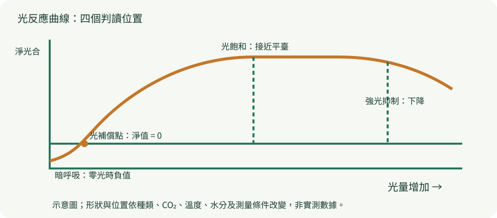

# 113 年果樹學｜逐題教學詳解

共 8 大題，小題合併於各大題。先理解原理，再練寫答案。配分重點為建議架構，不代表官方閱卷細則。

## 第一題｜名詞（15 分）

### 題意與作答範圍

本題重點：**名詞**。下列依題目主題整理答案；題幹、選項與圖表請對照[原始試卷](../../A113.pdf#page=2)。

### 先掌握答案

(1)Aquaporin：水通道蛋白，位於細胞膜或液泡膜，促進選擇性水分通過。

(2)Anti-florigen：抑花訊號，常指與 FT 促花系統拮抗的蛋白／訊號，抑制莖頂轉為生殖生長。

(3)Floral evocation：花誘發，莖頂受成花訊號後產生生化、生理變化，繼而轉入花芽形成。

(4)June drop：六月落果，指春季坐果後因同化物競爭、種子或激素訊號等形成的生理落果，名稱源自北半球物候。

(5)Apoplastic phloem loading：質外體韌皮部裝載，糖先由葉肉等細胞輸出至質外體，再以 H⁺／蔗糖共運輸進入伴細胞／篩管。

### 原理拆解：為什麼會這樣？

**先把源與庫接起來**

成熟葉通常是淨輸出同化物的源，果實、幼芽及根等是利用或貯藏同化物的庫。糖由葉肉到小葉脈，經伴細胞—篩管裝載，沿葉柄、枝幹與果梗韌皮部運輸，到果實卸載再由果肉利用或存入液泡。

**壓力流與跨膜運輸不是同一層次**

源端糖裝載降低水勢，吸水建立較高膨壓；庫端卸糖降低壓力，形成長距離質流。共質體路徑走胞間連絲，質外體路徑需糖跨膜轉運；H⁺-ATPase 建立電化學梯度，可支援 H⁺／蔗糖共運輸。

**庫強決定競爭，不只看果實大小**

庫強可概念化為庫大小乘單位活性，受細胞數、膨大、種子激素、維管連結及糖分解貯藏能力影響。其他果實與新梢亦競爭同化物；疏果能增加單果分配，但過度疏果降低總收量，需在品質與產量間取捨。

**先理解水勢與膨壓**

水由較高水勢流向較低水勢。細胞內溶質降低滲透勢，使水進入並建立膨壓；膨壓維持葉片挺立，也是細胞擴張的重要驅動力。因此缺水初期，即使葉片尚未明顯枯死，生長速度也可能先下降。

**由缺水到減產的連鎖**

根域變乾、葉水勢下降後，ABA 等訊號促氣孔關閉以節水；但 CO₂ 進入也減少，光合供碳受限。缺水再加重會破壞膜、酵素與運輸，造成落花落果、果實小與葉片早衰。復水後是否恢復，取決逆境強度、時間及受傷器官。

**管理不是只問澆多少**

應先看土壤保水與排水、根深、作物生育期及蒸散需求，用根域含水或水勢、植株狀態訂補水時機。覆蓋可減土面蒸發，滴灌可提高供水效率，但若根已病死或缺氧，增加灌水反而可能使吸水更差。

### 逐項辨析：定義之外還要知道什麼

| 本題答案項目 | 解析與辨別重點 |
| --- | --- |
| (1)Aquaporin：水通道蛋白，位於細胞膜或液泡膜，促進選擇性水分通過。 | 它提供水的通道，但水仍依水勢梯度移動，並非蛋白主動搬運水分子。 |
| (2)Anti-florigen：抑花訊號，常指與 FT 促花系統拮抗的蛋白／訊號，抑制莖頂轉為生殖生長。 | 應寫抑制成花訊號或莖頂生殖轉變，不等同已開花後花瓣提早凋謝。 |
| (4)June drop：六月落果，指春季坐果後因同化物競爭、種子或激素訊號等形成的生理落果，名稱源自北半球物候。 | 名稱是物候慣稱，臺灣或不同緯度不必恰在國曆六月，且須與病蟲或機械落果區分。 |
| (5)Apoplastic phloem loading：質外體韌皮部裝載，糖先由葉肉等細胞輸出至質外體，再以 H⁺／蔗糖共運輸進入伴細胞／篩管。 | 質外體路徑遇到選擇性膜界面時仍須跨膜運輸，不能理解為糖可一路無限制穿過所有組織。 |

### 這題要特別注意

花誘發不是開花；

水通道不消耗 ATP 主動抽水，水流方向仍取決於水勢梯度。

### 可直接練寫的完整答案

(1)Aquaporin：水通道蛋白，位於細胞膜或液泡膜，促進選擇性水分通過。

(2)Anti-florigen：抑花訊號，常指與 FT 促花系統拮抗的蛋白／訊號，抑制莖頂轉為生殖生長。

(3)Floral evocation：花誘發，莖頂受成花訊號後產生生化、生理變化，繼而轉入花芽形成。

(4)June drop：六月落果，指春季坐果後因同化物競爭、種子或激素訊號等形成的生理落果，名稱源自北半球物候。

(5)Apoplastic phloem loading：質外體韌皮部裝載，糖先由葉肉等細胞輸出至質外體，再以 H⁺／蔗糖共運輸進入伴細胞／篩管。

成熟葉通常是淨輸出同化物的源，果實、幼芽及根等是利用或貯藏同化物的庫。糖由葉肉到小葉脈，經伴細胞—篩管裝載，沿葉柄、枝幹與果梗韌皮部運輸，到果實卸載再由果肉利用或存入液泡。

### 實例：把原理用在情境中

同一樹上果實負載增加，若健康受光葉量不變，單果可分得的碳可能下降。這能解釋為何保葉、疏果與控制徒長枝，常比單獨追加「甜果肥」更重要。

旱後突然大水可讓部分果實內部快速吸水膨大，外皮卻來不及延展，增加裂果。因此穩定供水有時比季節總水量更能解釋商品率。

### 配分重點：哪些內容不能漏？

15 分：五名詞各 3 分，位置／作用與一個區別。

細項為依題意整理的建議得分內容，並非校方公布的評分細則。作答時依原題小題順序，讓定義、機制、實例與管理措施互相對應。

### 常見錯誤與修正

- 把長距離糖運輸寫成主要沿木質部。
- 把有水等同根一定能吸到水。
- 只抄中文名稱，漏掉題目要求的構造、英文、例子或區別。

## 第二題｜更年性與非更年性果實的乙烯反應（6 分）

### 題意與作答範圍

本題重點：**更年性與非更年性果實的乙烯反應**。下列依題目主題整理答案；題幹、選項與圖表請對照[原始試卷](../../A113.pdf#page=2)。

### 先掌握答案

更年性果實在達生理成熟、能回應乙烯的階段，外源乙烯可提早引發自催化乙烯與呼吸高峰；

### 原理拆解：為什麼會這樣？

**成熟反應與乙烯感受**

乙烯是氣態激素，與受體結合後解除受體對下游的負調節，經訊號與轉錄調控影響軟化、色素、香氣及衰老。反應取決種類、果齡、溫度、濃度與時間，不是所有組織都以相同方式回應。

**更年性與非更年性要比較反應型態**

具後熟能力的更年性果實，外源乙烯可啟動自催化乙烯與呼吸躍升，常主要改變高峰出現時間。非更年性也可能暫時增加呼吸或脫綠，但通常不發展同樣的自催化成熟程序；移除乙烯後的反應因此重要。

**催熟與延後成熟都不能忽略品質**

乙烯可整齊催熟已達生理成熟的果，卻不能讓極幼果補足田間累積不足的乾物；1-MCP 阻斷感受可延緩部分產品老化，但過強處理可能影響正常後熟。脫綠、果肉軟化和增甜亦不是必然同步。

### 這題要特別注意

兩類都可能回應乙烯；

不能寫成非更年性完全不受影響。

### 可直接練寫的完整答案

更年性果實在達生理成熟、能回應乙烯的階段，外源乙烯可提早引發自催化乙烯與呼吸高峰；

濃度達有效門檻後，增加濃度主要改變誘導時間，不能無限提高峰值。非更年性果實可在施用乙烯期間暫時提高呼吸，反應常隨濃度而增，移除後下降，通常不誘發典型自催化成熟高峰。

乙烯是氣態激素，與受體結合後解除受體對下游的負調節，經訊號與轉錄調控影響軟化、色素、香氣及衰老。反應取決種類、果齡、溫度、濃度與時間，不是所有組織都以相同方式回應。

具後熟能力的更年性果實，外源乙烯可啟動自催化乙烯與呼吸躍升，常主要改變高峰出現時間。非更年性也可能暫時增加呼吸或脫綠，但通常不發展同樣的自催化成熟程序；移除乙烯後的反應因此重要。

### 實例：把原理用在情境中

香蕉在不當高溫下，果肉可軟化而果皮仍綠，顯示果肉成熟與葉綠素降解可不同步。不能僅看果皮未黃，就判斷乙烯完全沒有作用。

### 配分重點：哪些內容不能漏？

6 分：濃度、峰值／時序、移除後差異，不把非更年性說成零反應。

- **峰值／時序**
- **移除後差異，不把非更年性說成零反應**

細項為依題意整理的建議得分內容，並非校方公布的評分細則。作答時依原題小題順序，讓定義、機制、實例與管理措施互相對應。

### 常見錯誤與修正

- 說非更年性果實完全不會回應乙烯。

## 第三題｜有子葡萄無子化（9 分）

### 題意與作答範圍

本題重點：**有子葡萄無子化**。下列依題目主題整理答案；題幹、選項與圖表請對照[原始試卷](../../A113.pdf#page=2)。

### 先掌握答案

依品種在開花前或盛花附近以 GA₃ 處理花穗，干擾受精／種子發育，形成無子果；

### 原理拆解：為什麼會這樣？

**先問有沒有受精**

單為結果不需要受精便使子房發育；有些完全不需授粉，有些需授粉刺激但仍不完成受精。種子敗育型則曾受精，後來胚或胚乳發育失敗，因此常留種痕。分類看發育過程，不是只看成熟果有沒有硬種。

**為何沒有正常種子仍能結果**

正常發育種子會提供或誘導支持子房生長的激素訊號。遺傳性單為結果或外施調節劑可在缺乏受精時提供相似支持；種子敗育型則可能在初期已建立足以使果實繼續生長的條件。

**無子化與膨大必須分開思考**

有子葡萄的無子化須依品種、花期以合適處理影響種子形成，花後可能另需促果粒膨大。時機錯誤會落果、穗軸或果粒異常；不能給一個濃度宣稱適用所有葡萄。無融合生殖是無正常有性受精而產胚，仍可有種子，並非同義詞。

**花序在新梢，結果能力卻與芽的過去有關**

葡萄新梢由結果母枝上的芽萌發，芽內花序原基常已在之前的枝梢生長期間形成。修剪改變芽的萌發機會，因此產期安排要先確認枝條與芽成熟度，不能把修剪當成憑空製造花芽。

**一年二收需要兩次完整資源循環**

冬剪後萌芽開花取得第一期果；採後保健康葉、適量補水肥，恢復貯藏並培養下一期成熟枝，再夏剪萌芽取得第二期。若第一期負載過大或葉片早落，第二期即使萌芽也可能花弱、著果差或糖低。

**促成與二收各有環境限制**

春果促成靠保溫設施與提早萌芽，使低溫季仍能發育；冬果則要防秋冬光熱不足。兩者均需疏梢、整穗及葉果比管理，日期依品種、產區與設施倒推，不宜用一個月份表套全臺。

### 這題要特別注意

無子化與膨大是不同處理階段，時期錯誤可造成落果、穗軸硬化或品質下降；

藥劑組合不是所有品種通用。

### 可直接練寫的完整答案

依品種在開花前或盛花附近以 GA₃ 處理花穗，干擾受精／種子發育，形成無子果；

部分品種配合適期鏈黴素處理提高無子率，花後再以 GA₃ 等促進果粒膨大，並調整穗形、疏粒與負載。

單為結果不需要受精便使子房發育；有些完全不需授粉，有些需授粉刺激但仍不完成受精。種子敗育型則曾受精，後來胚或胚乳發育失敗，因此常留種痕。分類看發育過程，不是只看成熟果有沒有硬種。

正常發育種子會提供或誘導支持子房生長的激素訊號。遺傳性單為結果或外施調節劑可在缺乏受精時提供相似支持；種子敗育型則可能在初期已建立足以使果實繼續生長的條件。

### 實例：把原理用在情境中

栽培香蕉可用作單為結果例，許多無子葡萄作種子敗育例；柑橘珠心胚說明無融合生殖可產生帶胚種子，三者不能互換。

同一園連續兩期採滿量而不保留健康葉，短期總採收似多，卻可能使翌期枝條與花芽變差；合理負載應看跨季樹勢與商品果率。

### 配分重點：哪些內容不能漏？

9 分：花期無子化與花後膨大、品種時機、葉果比與風險。

- **花期無子化與花後膨大**
- **品種時機**
- **葉果比與風險**

細項為依題意整理的建議得分內容，並非校方公布的評分細則。作答時依原題小題順序，讓定義、機制、實例與管理措施互相對應。

### 常見錯誤與修正

- 把所有無子葡萄都說成未曾受精。
- 以為剪枝本身就使任何芽都能帶花。

## 第四題｜矮性砧木蘋果密植增產（20 分）

### 題意與作答範圍

本題重點：**矮性砧木蘋果密植增產**。下列依題目主題整理答案；題幹、選項與圖表請對照[原始試卷](../../A113.pdf#page=2)。

### 先掌握答案

矮砧限制樹體營養生長，縮短幼年、促進早結果；

### 原理拆解：為什麼會這樣？

**產量要以單位土地和有效葉面積看**

大樹不一定比小冠密植高產，因為冠內葉片可能長期受陰。產量與品質取決土地截光、光分布、葉片利用效率，以及同化物分給果實的比例；單株產量與每公頃產量必須分別討論。

**整枝、修剪和負載互相制約**

整枝建立骨架與結果部位，修剪移除特定枝芽葉，拉枝改變角度與優勢，疏果降低庫競爭。操作須保留足量健康葉；過重剪雖降低高度，卻會減供碳並促旺梢，不保證提高當期花果。

**矮化與密植的效益有條件**

矮砧、低幹與細長冠可早形成土地有效葉面積、方便作業，且減大型骨架消耗；但過密仍會陰蔽、著色差與病害。支架、灌溉、疏果及持續更新是技術成本，不應只列早產優點。

### 這題要特別注意

密植並非愈密愈好；

冠層過度封閉會降低花芽形成、著色和果實品質。應區分單株產量與每公頃產量。

### 可直接練寫的完整答案

矮砧限制樹體營養生長，縮短幼年、促進早結果；

細長樹冠可提高單位土地早期葉面積與光截取，更多葉片維持在有效受光範圍，減少冠內陰葉。較少同化物用於大型骨幹和徒長枝，增加分配至果實的比例，提升收穫指數與單位土地產量；

配合支架、灌溉與疏果維持樹勢。

大樹不一定比小冠密植高產，因為冠內葉片可能長期受陰。產量與品質取決土地截光、光分布、葉片利用效率，以及同化物分給果實的比例；單株產量與每公頃產量必須分別討論。

整枝建立骨架與結果部位，修剪移除特定枝芽葉，拉枝改變角度與優勢，疏果降低庫競爭。操作須保留足量健康葉；過重剪雖降低高度，卻會減供碳並促旺梢，不保證提高當期花果。

### 實例：把原理用在情境中

矮砧蘋果密植常可提高早期每公頃產量，即使單株產量較低；若後期冠層封閉卻不調枝，早期優勢會被陰蔽與品質下降抵銷。

### 配分重點：哪些內容不能漏？

20 分：樹冠組成、光截取、同化物分配三面，說明每公頃與每株不同。

- **樹冠組成**
- **光截取**
- **同化物分配三面，說明每公頃與每株不同**

細項為依題意整理的建議得分內容，並非校方公布的評分細則。作答時依原題小題順序，讓定義、機制、實例與管理措施互相對應。

### 常見錯誤與修正

- 把修剪一律理解為越重越好。

## 第五題｜光反應曲線及超過飽和點的改善（15 分）

### 題意與作答範圍

本題重點：**光反應曲線及超過飽和點的改善**。下列依題目主題整理答案；題幹、選項與圖表請對照[原始試卷](../../A113.pdf#page=2)。

### 先掌握答案

以橫軸光量、縱軸淨光合速率：零光時為負值，其絕對值為暗呼吸；

### 原理拆解：為什麼會這樣？

**淨光合是固定與消耗的差額**

在零光時仍有呼吸，淨 CO₂ 交換可為負；補償點是淨交換為零，不表示光合作用或呼吸停止。光量再增加時光合上升，至其他因素限制而接近飽和。

**超過飽和不等於一定立刻受傷**

飽和代表增加光量的邊際收益小；光抑制則是強光造成光合效率下降，兩者不同。葉溫、CO₂、氣孔、水分與光系統狀態會改變曲線，陰葉與陽葉也不能共用固定數值。

**管理要讓真正的限制因子改善**

改善冠層光分布可讓陰葉利用光，提高適宜 CO₂ 或降低熱與水分壓力可能改善效率。若已有高溫失水，單純加光常無效；遮陰也須避免過度降低每日有效同化量。

### 這題要特別注意

示意：`淨光合：負值 → 0 → 上升 → 平臺 → 強光下降`。飽和只是當下某限制因子開始主導，不代表增加光可繼續增加同一葉片的光合量。

### 可直接練寫的完整答案

以橫軸光量、縱軸淨光合速率：零光時為負值，其絕對值為暗呼吸；

曲線穿越零點為光補償點；

光增加後達平臺的起始區為光飽和點；

強光導致光合速率下降時為光抑制。超過飽和點可提高適當 CO₂ 供應、使葉溫與氣孔狀態適宜、補足水分與養分；

整枝改善光分布，使原本陰葉利用多餘光量，熱害時適度遮蔭。

在零光時仍有呼吸，淨 CO₂ 交換可為負；補償點是淨交換為零，不表示光合作用或呼吸停止。光量再增加時光合上升，至其他因素限制而接近飽和。

飽和代表增加光量的邊際收益小；光抑制則是強光造成光合效率下降，兩者不同。葉溫、CO₂、氣孔、水分與光系統狀態會改變曲線，陰葉與陽葉也不能共用固定數值。

### 圖解輔助

示意圖用來理解結構與方向；考場仍須依原題標示軸名、箭頭或構造。

### 實例：把原理用在情境中

密植果園外層葉受光已接近飽和，內層葉卻低於補償點；合理疏枝可提高內層受光，而非只是讓外層葉接受更多光。

### 配分重點：哪些內容不能漏？

15 分：圖標軸及四點、超飽和後限制因子、CO₂／葉溫／冠層實例。

- **圖標軸及四點**
- **超飽和後限制因子**
- **CO₂／葉溫／冠層實例**

細項為依題意整理的建議得分內容，並非校方公布的評分細則。作答時依原題小題順序，讓定義、機制、實例與管理措施互相對應。

### 常見錯誤與修正

- 將光補償點寫成沒有呼吸。

## 第六題｜整枝目的與形式（10 分）

### 題意與作答範圍

本題重點：**整枝目的與形式**。下列依題目主題整理答案；題幹、選項與圖表請對照[原始試卷](../../A113.pdf#page=2)。

### 先掌握答案

目的為建立穩固骨架、改善通風採光、調整樹勢與結果部位、降低病害並便於採收。開心形：桃等幼樹去中央主幹、選 3–4 主枝向外開展。中央領導幹／細長紡錘形：蘋果等保留主軸、側枝分層且上小下大，利用拉枝與疏枝維持光分布。

### 原理拆解：為什麼會這樣？

**產量要以單位土地和有效葉面積看**

大樹不一定比小冠密植高產，因為冠內葉片可能長期受陰。產量與品質取決土地截光、光分布、葉片利用效率，以及同化物分給果實的比例；單株產量與每公頃產量必須分別討論。

**整枝、修剪和負載互相制約**

整枝建立骨架與結果部位，修剪移除特定枝芽葉，拉枝改變角度與優勢，疏果降低庫競爭。操作須保留足量健康葉；過重剪雖降低高度，卻會減供碳並促旺梢，不保證提高當期花果。

**矮化與密植的效益有條件**

矮砧、低幹與細長冠可早形成土地有效葉面積、方便作業，且減大型骨架消耗；但過密仍會陰蔽、著色差與病害。支架、灌溉、疏果及持續更新是技術成本，不應只列早產優點。

### 這題要特別注意

整枝是樹形的建立，修剪是實現與維持樹形的手段之一。

### 可直接練寫的完整答案

目的為建立穩固骨架、改善通風採光、調整樹勢與結果部位、降低病害並便於採收。開心形：桃等幼樹去中央主幹、選 3–4 主枝向外開展。中央領導幹／細長紡錘形：蘋果等保留主軸、側枝分層且上小下大，利用拉枝與疏枝維持光分布。

大樹不一定比小冠密植高產，因為冠內葉片可能長期受陰。產量與品質取決土地截光、光分布、葉片利用效率，以及同化物分給果實的比例；單株產量與每公頃產量必須分別討論。

整枝建立骨架與結果部位，修剪移除特定枝芽葉，拉枝改變角度與優勢，疏果降低庫競爭。操作須保留足量健康葉；過重剪雖降低高度，卻會減供碳並促旺梢，不保證提高當期花果。

### 實例：把原理用在情境中

矮砧蘋果密植常可提高早期每公頃產量，即使單株產量較低；若後期冠層封閉卻不調枝，早期優勢會被陰蔽與品質下降抵銷。

### 配分重點：哪些內容不能漏？

10 分：整枝目的、兩樹形、實施與作物例。

- **整枝目的**
- **兩樹形**
- **實施與作物例**

細項為依題意整理的建議得分內容，並非校方公布的評分細則。作答時依原題小題順序，讓定義、機制、實例與管理措施互相對應。

### 常見錯誤與修正

- 把修剪一律理解為越重越好。

## 第七題｜15-15-15-4 肥料元素計算（10 分）

### 題意與作答範圍

本題重點：**15-15-15-4 肥料元素計算**。下列依題目主題整理答案；題幹、選項與圖表請對照[原始試卷](../../A113.pdf#page=2)。

### 先掌握答案

肥料標示前三項為 N、P₂O₅、K₂O 百分率。10 kg 中：N＝10×0.15＝**1.50 kg**；

P＝10×0.15×(2×31)/(2×31+5×16)＝1.5×62/142＝**0.655 kg**；

K＝10×0.15×(2×39)/(2×39+16)＝1.5×78/94＝**1.245 kg**。

### 原理拆解：為什麼會這樣？

**先寫定義與單位再代數字**

肥料百分率是重量基準，N 直接以元素量標示，磷與鉀通常以 P₂O₅、K₂O 表示；莫耳濃度則須分清一莫耳化合物含幾莫耳目標元素。題目單位不同，公式不可直接共用。

**保留換算比例才能檢查**

氧化物換元素用元素在該化學式的質量比例；母液稀釋先算目標莫耳數再除以母液濃度。DIF 用日溫減夜溫，均溫則按時數加權，pF 使用以公分水柱表示的壓力頭取常用對數。

**答案需列假設與合理位數**

先顯示式子，後列數值和單位。原題若原子量誤植或缺少盆徑與冠幅比例等條件，應說明正確知識及缺少的假設，不能以一個看似精確的數字掩蓋資訊不足。

### 這題要特別注意

第四個數字常為 MgO，需依標籤確認，但不影響本題。不能把 1.5 kg 的 P₂O₅ 當成 1.5 kg 元素磷。

### 可直接練寫的完整答案

以下依各小題順序列公式、代入與結果：

肥料標示前三項為 N、P₂O₅、K₂O 百分率。10 kg 中：N＝10×0.15＝**1.50 kg**；

P＝10×0.15×(2×31)/(2×31+5×16)＝1.5×62/142＝**0.655 kg**；

K＝10×0.15×(2×39)/(2×39+16)＝1.5×78/94＝**1.245 kg**。

### 實例：把原理用在情境中

15% P₂O₅ 不等於 15% 元素磷：需乘 62/142；15% K₂O 轉元素鉀需乘 78/94。只有標示 N 可直接以其百分率計算元素氮。

### 配分重點：哪些內容不能漏？

10 分：N、P、K 分別列式及單位，P₂O₅、K₂O 轉元素，不計未問第四項。

- **K 分別列式及單位，P₂O₅**
- **K₂O 轉元素，不計未問第四項**

細項為依題意整理的建議得分內容，並非校方公布的評分細則。作答時依原題小題順序，讓定義、機制、實例與管理措施互相對應。

### 常見錯誤與修正

- 把 P₂O₅ 的重量直接當成元素磷。

## 第八題｜表 2 實驗設計與結果判讀（15 分）

### 題意與作答範圍

本題重點：**表 2 實驗設計與結果判讀**。下列依題目主題整理答案；題幹、選項與圖表請對照[原始試卷](../../A113.pdf#page=2)。

### 先掌握答案

從表可辨識果園種類 O（蘋果、桃）、地表處理 T（除草劑、整合刈草）及年份 Y（2018、2019）等因子，評估覆蓋率、雜草種數與乾生物量；

### 原理拆解：為什麼會這樣？

**先交代因子、層級與反應變數**

閱讀變方分析表時先列處理因子及其水準，再列測量指標和單位。資料表能顯示比較內容，但未必足以重建隨機化、區集、樣本數與重複量測結構；設計資訊不足應明確說明。

**先判交互作用，再解釋主效應**

交互作用表示一因子的效果隨另一因子水準而變。若交互作用顯著，整體平均主效應不一定代表每一組合，宜比較簡單效應或相應組合；不顯著也不是證明兩者完全相等。

**顯著性與效應大小都要寫**

依事先設定的 α 判定 p 值，再用平均值、差額與單位描述方向。p 小不代表差異一定有生產價值，p 大也不代表效果為零；表中沒有的因果與實驗細節不應補造。

### 這題要特別注意

「不顯著」不代表完全相同；

表沒有產量或土壤氮數據，不能由它證明刈草增產、氮增加或除草劑殘留造成傷害。題幹說明的背景也不能取代表內證據。[研究原文](https://www.mdpi.com/2311-7524/6/4/96)

### 可直接練寫的完整答案

從表可辨識果園種類 O（蘋果、桃）、地表處理 T（除草劑、整合刈草）及年份 Y（2018、2019）等因子，評估覆蓋率、雜草種數與乾生物量；

有 O×T、O×Y、T×Y、O×T×Y 交互作用。表本身無法確認區集、重複數、隨機化或是否重複量測，不應捏造。以 α＝0.05：果園主效應三項均不顯著（0.063、0.138、0.060）；

整合刈草三項均顯著高於除草劑，分別為 92.3% 對 32.9%、7.0 對 2.2 種、137 對 55.5 g/m²。年份覆蓋率不顯著，2018 種數與乾重高於 2019。O×Y 三項顯著，故年份或果園效果宜進一步做簡單效應；

其他列出的交互作用不顯著。

閱讀變方分析表時先列處理因子及其水準，再列測量指標和單位。資料表能顯示比較內容，但未必足以重建隨機化、區集、樣本數與重複量測結構；設計資訊不足應明確說明。

### 實例：把原理用在情境中

若刈草處理使覆蓋率顯著高於除草劑，應同時寫出兩者平均值與單位；若果園×年份顯著，則不可只用兩年合併平均宣布某種果園永遠較高。

### 配分重點：哪些內容不能漏？

15 分：可推因子與未知設計、三主效應、交互作用、顯著性與不能推出的結論。

- **可推因子與未知設計**
- **三主效應**
- **交互作用**
- **顯著性與不能推出的結論**

細項為依題意整理的建議得分內容，並非校方公布的評分細則。作答時依原題小題順序，讓定義、機制、實例與管理措施互相對應。

### 常見錯誤與修正

- 看到 p>0.05 就寫成完全沒有差別。
