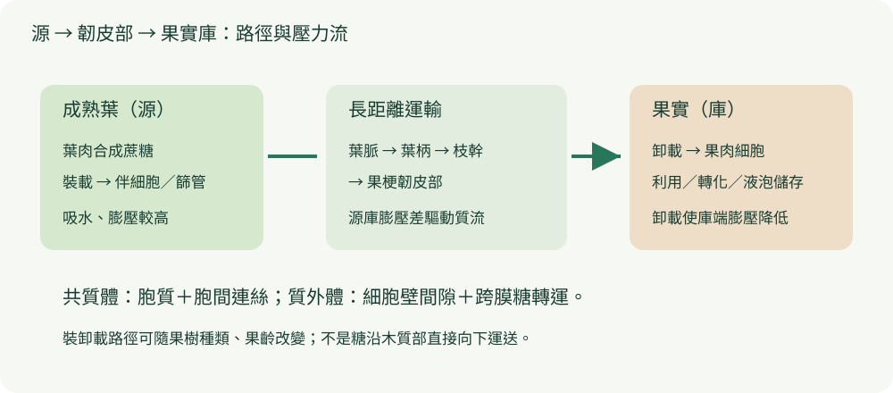

# 93 年園藝植物學｜逐題教學詳解

共 5 大題，小題合併於各大題。先理解原理，再練寫答案。配分重點為建議架構，不代表官方閱卷細則。

## 第一題｜細胞膜與壁圖、構造功能（20 分）

### 題意與作答範圍

本題重點：**細胞膜與壁圖、構造功能**。下列依題目主題整理答案；題幹、選項與圖表請對照[原始試卷](../../541491416.pdf#page=42)。

### 先掌握答案

由外至內畫「相鄰細胞—中膠層—初生壁—必要時次生壁—質膜—細胞質」，標胞間連絲穿壁連兩胞。壁以纖維素微纖絲為骨架，半纖維素、果膠與蛋白形成網，賦形支撐、抗膨壓與成長延展，中膠層果膠黏合。膜畫磷脂雙層、親水頭向水相、疏水尾內向，含蛋白、固醇及糖鏈，負責選擇運輸、訊號與電化學梯度。膜流動性與壁可塑性共同使細胞生長且不破裂。

### 原理拆解：為什麼會這樣？

**構造位置與功能要對得上**

植物細胞外側有細胞壁，內側為選擇性通透的質膜；細胞質內的細胞器各有分工。成熟液泡細胞常具大型中央液泡，並非所有植物細胞都同樣有大量葉綠體。

**膜維持隔室與可控制的運輸**

脂雙層與膜蛋白形成選擇性屏障，通道、載體與幫浦控制物質移動；細胞壁則以纖維素等形成機械支撐，並參與生長、黏合與防禦。水分可影響膨壓，但細胞壁不是主要選擇性膜。

**圖示必須呈現關係**

畫細胞壁、質膜、中央液泡與細胞核，再標葉綠體、粒線體、內質網、高基氏體及核糖體等，標線避免交錯。葉綠體光合與粒線體呼吸可同存於綠色細胞，不可把兩者畫成互斥。

### 可直接練寫的完整答案

由外至內畫「相鄰細胞—中膠層—初生壁—必要時次生壁—質膜—細胞質」，標胞間連絲穿壁連兩胞。壁以纖維素微纖絲為骨架，半纖維素、果膠與蛋白形成網，賦形支撐、抗膨壓與成長延展，中膠層果膠黏合。膜畫磷脂雙層、親水頭向水相、疏水尾內向，含蛋白、固醇及糖鏈，負責選擇運輸、訊號與電化學梯度。膜流動性與壁可塑性共同使細胞生長且不破裂。

植物細胞外側有細胞壁，內側為選擇性通透的質膜；細胞質內的細胞器各有分工。成熟液泡細胞常具大型中央液泡，並非所有植物細胞都同樣有大量葉綠體。

脂雙層與膜蛋白形成選擇性屏障，通道、載體與幫浦控制物質移動；細胞壁則以纖維素等形成機械支撐，並參與生長、黏合與防禦。水分可影響膨壓，但細胞壁不是主要選擇性膜。

### 實例：把原理用在情境中

根部多數細胞不直接行光合作用，仍有粒線體供能；葉肉細胞可同時具有葉綠體與粒線體，白天也需要呼吸與其他代謝。

### 配分重點：哪些內容不能漏？

20 分：壁層與微纖絲、流動鑲嵌膜、通道／幫浦、結構功能、示意圖。

- **壁層與微纖絲**
- **流動鑲嵌膜**
- **通道／幫浦**
- **結構功能**
- **示意圖**

細項為依題意整理的建議得分內容，並非校方公布的評分細則。作答時依原題小題順序，讓定義、機制、實例與管理措施互相對應。

### 常見錯誤與修正

- 把細胞壁當成選擇性控制離子的主要界面。

## 第二題｜氣孔開閉機制與環境（20 分）

### 題意與作答範圍

本題重點：**氣孔開閉機制與環境**。下列依題目主題整理答案；題幹、選項與圖表請對照[原始試卷](../../541491416.pdf#page=42)。

### 先掌握答案

光尤其藍光啟動保衛細胞 H⁺-ATPase，膜超極化促 K⁺ 及相應陰離子／有機酸累積，水勢下降、吸水膨壓上升；

### 原理拆解：為什麼會這樣？

**保衛細胞膨壓改變孔隙**

光與訊號可調控質膜 H⁺ 幫浦及離子通道，促進 K⁺、陰離子或其他滲透物累積，水隨水勢梯度進入使保衛細胞膨壓上升；細胞壁幾何使氣孔開啟。關閉則伴隨離子與水外流。

**光、CO₂ 與水分訊號共同作用**

藍光可促開孔，葉內 CO₂ 與光合需求參與調控；乾旱時 ABA 訊號及水力狀態促關孔，以降低失水。反應受物種、時段與環境影響，不宜簡化為所有植物白天都開、晚上都關。

**節水與碳吸收之間存在取捨**

氣孔關閉降低蒸散，也限制 CO₂ 進入並可能提高葉溫。作物長期水分利用效率須合併產量評估；單看蒸散降低不能判定整體生長一定受益。

### 可直接練寫的完整答案

光尤其藍光啟動保衛細胞 H⁺-ATPase，膜超極化促 K⁺ 及相應陰離子／有機酸累積，水勢下降、吸水膨壓上升；

特殊細胞壁形狀使孔開。黑暗、乾旱 ABA 與高 CO₂ 等訊號引陰離子及 K⁺ 外流、水退出、膨壓降而閉。光、CO₂、葉水勢、VPD、溫度與生理時鐘共同調控；

氣孔開有助碳固定卻增加失水，CAM 常夜開以節水。

光與訊號可調控質膜 H⁺ 幫浦及離子通道，促進 K⁺、陰離子或其他滲透物累積，水隨水勢梯度進入使保衛細胞膨壓上升；細胞壁幾何使氣孔開啟。關閉則伴隨離子與水外流。

藍光可促開孔，葉內 CO₂ 與光合需求參與調控；乾旱時 ABA 訊號及水力狀態促關孔，以降低失水。反應受物種、時段與環境影響，不宜簡化為所有植物白天都開、晚上都關。

### 實例：把原理用在情境中

乾旱使一般 C₃ 蔬菜氣孔關閉，短期保水，卻可能降低光合與膨大；CAM 植物的典型夜間開孔則須另依其日韻律解釋。

### 配分重點：哪些內容不能漏？

20 分：幫浦→離子→水勢→膨壓鏈、閉孔訊號、環境與權衡。

- **幫浦→離子→水勢→膨壓鏈**
- **閉孔訊號**
- **環境與權衡**

細項為依題意整理的建議得分內容，並非校方公布的評分細則。作答時依原題小題順序，讓定義、機制、實例與管理措施互相對應。

### 常見錯誤與修正

- 把水分進出說成主動耗 ATP 搬運水分子。

## 第三題｜光合物從葉到果（20 分）

### 題意與作答範圍

本題重點：**光合物從葉到果**。下列依題目主題整理答案；題幹、選項與圖表請對照[原始試卷](../../541491416.pdf#page=42)。

### 先掌握答案

葉肉葉綠體固定碳，糖在細胞質形成蔗糖，經葉肉—小葉脈伴細胞—篩管裝載，沿葉柄、枝幹、果梗韌皮部入果實，卸載至果肉再利用或液泡貯藏。源端裝載降低水勢、木質部水進篩管升壓，庫端卸載降壓，形成壓力流；

### 原理拆解：為什麼會這樣？

**先把源與庫接起來**

成熟葉通常是淨輸出同化物的源，果實、幼芽及根等是利用或貯藏同化物的庫。糖由葉肉到小葉脈，經伴細胞—篩管裝載，沿葉柄、枝幹與果梗韌皮部運輸，到果實卸載再由果肉利用或存入液泡。

**壓力流與跨膜運輸不是同一層次**

源端糖裝載降低水勢，吸水建立較高膨壓；庫端卸糖降低壓力，形成長距離質流。共質體路徑走胞間連絲，質外體路徑需糖跨膜轉運；H⁺-ATPase 建立電化學梯度，可支援 H⁺／蔗糖共運輸。

**庫強決定競爭，不只看果實大小**

庫強可概念化為庫大小乘單位活性，受細胞數、膨大、種子激素、維管連結及糖分解貯藏能力影響。其他果實與新梢亦競爭同化物；疏果能增加單果分配，但過度疏果降低總收量，需在品質與產量間取捨。

### 可直接練寫的完整答案

葉肉葉綠體固定碳，糖在細胞質形成蔗糖，經葉肉—小葉脈伴細胞—篩管裝載，沿葉柄、枝幹、果梗韌皮部入果實，卸載至果肉再利用或液泡貯藏。源端裝載降低水勢、木質部水進篩管升壓，庫端卸載降壓，形成壓力流；

共質體與質外體路徑依物種與時期不同。

成熟葉通常是淨輸出同化物的源，果實、幼芽及根等是利用或貯藏同化物的庫。糖由葉肉到小葉脈，經伴細胞—篩管裝載，沿葉柄、枝幹與果梗韌皮部運輸，到果實卸載再由果肉利用或存入液泡。

源端糖裝載降低水勢，吸水建立較高膨壓；庫端卸糖降低壓力，形成長距離質流。共質體路徑走胞間連絲，質外體路徑需糖跨膜轉運；H⁺-ATPase 建立電化學梯度，可支援 H⁺／蔗糖共運輸。

### 圖解輔助

示意圖用來理解結構與方向；考場仍須依原題標示軸名、箭頭或構造。

### 實例：把原理用在情境中

同一樹上果實負載增加，若健康受光葉量不變，單果可分得的碳可能下降。這能解釋為何保葉、疏果與控制徒長枝，常比單獨追加「甜果肥」更重要。

### 配分重點：哪些內容不能漏？

20 分：完整組織、裝卸載、能量與壓力流、貯藏位置。

- **完整組織**
- **裝卸載**
- **能量與壓力流**
- **貯藏位置**

細項為依題意整理的建議得分內容，並非校方公布的評分細則。作答時依原題小題順序，讓定義、機制、實例與管理措施互相對應。

### 常見錯誤與修正

- 把長距離糖運輸寫成主要沿木質部。

## 第四題｜有絲與減數分裂（20 分）

### 題意與作答範圍

本題重點：**有絲與減數分裂**。下列依題目主題整理答案；題幹、選項與圖表請對照[原始試卷](../../541491416.pdf#page=42)。

### 先掌握答案

有絲分裂一次核分裂，通常形成兩個與母細胞同倍數、遺傳近同的子細胞，支持根莖葉生長、癒傷及扦插組培保持品種。減數分裂於有性生殖前經一次 DNA 複製、兩次分裂，同源配對與交換，形成染色體數減半、遺傳重組的孢子，再形成配子體及配子。其分離重組是雜交育種變異來源；

### 原理拆解：為什麼會這樣？

**減數分裂減半的是同源染色體組數**

DNA 先複製一次，再連續分裂兩次；第一次主要分開同源染色體，第二次分開姊妹染色分體。有絲分裂則通常保留原倍數。植物減數分裂先形成孢子，孢子再發育為配子體並產生配子，不能完全套用動物直接產配子的敘述。

**先區分基因型與表型**

基因型決定遺傳組合，表型則是基因型、環境及兩者交互作用的結果。相似表型不一定有相同基因型，環境造成的差異也不必然能遺傳給下一代。

**孟德爾比例有適用前提**

等位基因在減數分裂分離；不連鎖或相距夠遠的基因可近似獨立分配。3:1 或 9:3:3:1 的表型比還依完全顯性、相應交配方式及無其他干擾等條件，不是所有雜交都必須得到同一比例。

**例外要說明改變哪個前提**

緊密連鎖使親本型較多，上位作用改變基因間的表型組合，不完全顯性使雜合型可區辨，細胞質遺傳則可能有母系效應。多倍體、致死與選汰也會改變預期比例，不能只背例外名稱。

### 可直接練寫的完整答案

有絲分裂一次核分裂，通常形成兩個與母細胞同倍數、遺傳近同的子細胞，支持根莖葉生長、癒傷及扦插組培保持品種。減數分裂於有性生殖前經一次 DNA 複製、兩次分裂，同源配對與交換，形成染色體數減半、遺傳重組的孢子，再形成配子體及配子。其分離重組是雜交育種變異來源；

無性繁殖仍有突變可能，不是絕對零變異。

DNA 先複製一次，再連續分裂兩次；第一次主要分開同源染色體，第二次分開姊妹染色分體。有絲分裂則通常保留原倍數。植物減數分裂先形成孢子，孢子再發育為配子體並產生配子，不能完全套用動物直接產配子的敘述。

### 實例：把原理用在情境中

兩個緊密連鎖的番茄基因在測交後可能以親本組合為多，重組型較少；這是獨立分配前提不成立，不代表等位基因不再分離。

### 配分重點：哪些內容不能漏？

20 分：次數、倍數、產物與交換、植物孢子／配子區別、兩種園藝用途。

- **產物與交換**
- **植物孢子／配子區別**
- **兩種園藝用途**

細項為依題意整理的建議得分內容，並非校方公布的評分細則。作答時依原題小題順序，讓定義、機制、實例與管理措施互相對應。

### 常見錯誤與修正

- 認為表型比不符 9:3:3:1 就推翻全部遺傳定律。

## 第五題｜光呼吸與降低方法（20 分）

### 題意與作答範圍

本題重點：**光呼吸與降低方法**。下列依題目主題整理答案；題幹、選項與圖表請對照[原始試卷](../../541491416.pdf#page=42)。

### 先掌握答案

Rubisco 的加氧反應把 RuBP 轉成 3-PGA 與 2-磷酸乙醇酸，後者需經葉綠體、過氧化體、粒線體回收，耗能並釋 CO₂，降低淨碳固定，常在高溫、低 CO₂／高 O₂ 及氣孔關閉時增加。

### 原理拆解：為什麼會這樣？

**起點是 Rubisco 的加氧反應**

Rubisco 除羧化外也可催化 RuBP 加氧，產生須回收的含碳產物。光呼吸涉及葉綠體、過氧化體與粒線體，消耗能量並釋放部分 CO₂，通常降低 C₃ 植物的淨碳收益。

**高溫與低葉內 CO₂ 常加劇問題**

高溫改變氣體溶解與酵素選擇性，乾旱關孔降低葉內 CO₂，使加氧相對增加。光呼吸並非黑暗呼吸，也不能把所有光下 CO₂ 釋放都只歸因於同一途徑。

**降低損失須考慮生產條件**

適度降葉溫、維持供水與合宜 CO₂ 可改善羧化競爭；C₄ 與 CAM 利用濃縮 CO₂ 機制降低部分限制，但不能用它們的耐逆性推論所有環境都高產。光呼吸也有代謝與光保護角色，不宜描述成完全無功能。

### 可直接練寫的完整答案

Rubisco 的加氧反應把 RuBP 轉成 3-PGA 與 2-磷酸乙醇酸，後者需經葉綠體、過氧化體、粒線體回收，耗能並釋 CO₂，降低淨碳固定，常在高溫、低 CO₂／高 O₂ 及氣孔關閉時增加。

C4 以空間分離的 PEPC 固碳及維管束鞘濃縮 CO₂，CAM 以夜固碳晝脫羧時間分離，降低 Rubisco 周圍的氧化競爭。C3 管理可適當補 CO₂、維持葉溫與水分，但不能完全消除；

光呼吸亦有代謝及光保護功能。

Rubisco 除羧化外也可催化 RuBP 加氧，產生須回收的含碳產物。光呼吸涉及葉綠體、過氧化體與粒線體，消耗能量並釋放部分 CO₂，通常降低 C₃ 植物的淨碳收益。

### 實例：把原理用在情境中

夏季 C₃ 葉菜若高溫加缺水，關孔後光呼吸相對增加；適當遮陰降溫與均勻灌溉可比單純增加光強更有效改善碳收支。

### 配分重點：哪些內容不能漏？

20 分：Rubisco 氧化、回收三胞器與代價、C4／CAM、栽培方法及非全然無用。

- **Rubisco 氧化**
- **回收三胞器與代價**
- **C4／CAM**
- **栽培方法及非全然無用**

細項為依題意整理的建議得分內容，並非校方公布的評分細則。作答時依原題小題順序，讓定義、機制、實例與管理措施互相對應。

### 常見錯誤與修正

- 將光呼吸和粒線體一般呼吸寫成同義。
