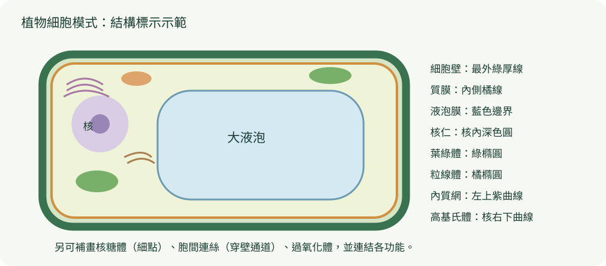

# 96 年園藝植物學｜逐題教學詳解

共 5 大題，小題合併於各大題。先理解原理，再練寫答案。配分重點為建議架構，不代表官方閱卷細則。

## 第一題｜植物細胞模式圖與十構造（20 分）

### 題意與作答範圍

本題重點：**植物細胞模式圖與十構造**。下列依題目主題整理答案；題幹、選項與圖表請對照[原始試卷](../../541491416.pdf#page=34)。

### 先掌握答案

可按由外至內畫：細胞壁→質膜→細胞質，中央大液泡及液泡膜；

### 原理拆解：為什麼會這樣？

**構造位置與功能要對得上**

植物細胞外側有細胞壁，內側為選擇性通透的質膜；細胞質內的細胞器各有分工。成熟液泡細胞常具大型中央液泡，並非所有植物細胞都同樣有大量葉綠體。

**膜維持隔室與可控制的運輸**

脂雙層與膜蛋白形成選擇性屏障，通道、載體與幫浦控制物質移動；細胞壁則以纖維素等形成機械支撐，並參與生長、黏合與防禦。水分可影響膨壓，但細胞壁不是主要選擇性膜。

**圖示必須呈現關係**

畫細胞壁、質膜、中央液泡與細胞核，再標葉綠體、粒線體、內質網、高基氏體及核糖體等，標線避免交錯。葉綠體光合與粒線體呼吸可同存於綠色細胞，不可把兩者畫成互斥。

### 可直接練寫的完整答案

可按由外至內畫：細胞壁→質膜→細胞質，中央大液泡及液泡膜；

另畫細胞核與核仁、葉綠體、粒線體、粗糙／平滑內質網、高基氏體、核糖體、過氧化體與胞間連絲。細胞壁支撐、膜選擇運輸、核儲遺傳與調控、葉綠體光合、粒線體呼吸供 ATP、內質網製蛋白／脂質、高基氏體修飾分泌、液泡維膨壓儲物與降解、胞間連絲連共質體。須畫位置與標線，文字清單不是圖本身。

植物細胞外側有細胞壁，內側為選擇性通透的質膜；細胞質內的細胞器各有分工。成熟液泡細胞常具大型中央液泡，並非所有植物細胞都同樣有大量葉綠體。

脂雙層與膜蛋白形成選擇性屏障，通道、載體與幫浦控制物質移動；細胞壁則以纖維素等形成機械支撐，並參與生長、黏合與防禦。水分可影響膨壓，但細胞壁不是主要選擇性膜。

### 圖解輔助

示意圖用來理解結構與方向；考場仍須依原題標示軸名、箭頭或構造。

### 實例：把原理用在情境中

根部多數細胞不直接行光合作用，仍有粒線體供能；葉肉細胞可同時具有葉綠體與粒線體，白天也需要呼吸與其他代謝。

### 配分重點：哪些內容不能漏？

20 分：圖具植物細胞特徵、至少十標示、結構與功能對應。

- **圖具植物細胞特徵**
- **至少十標示**
- **結構與功能對應**

細項為依題意整理的建議得分內容，並非校方公布的評分細則。作答時依原題小題順序，讓定義、機制、實例與管理措施互相對應。

### 常見錯誤與修正

- 把細胞壁當成選擇性控制離子的主要界面。

## 第二題｜五組形態比較（20 分）

### 題意與作答範圍

本題重點：**五組形態比較**。下列依題目主題整理答案；題幹、選項與圖表請對照[原始試卷](../../541491416.pdf#page=34)。

### 先掌握答案

完全葉有葉身、葉柄、托葉三部，如玫瑰；

不完全葉缺一部以上，如多數禾草缺典型葉柄。完全花具萼、瓣、雄、雌四輪，如番茄；

缺任一輪為不完全花，如瓜類單性花。鱗莖以肉質鱗片葉儲藏如百合，球莖為實心莖如唐菖蒲。根莖是有節芽橫走地下莖如薑；

匍匐莖多在地表延伸、節生新株如草莓。聚合果為單花多離生子房如番荔枝，多花果為花序多花形成如鳳梨。

### 原理拆解：為什麼會這樣？

**器官來源比外觀名稱更可靠**

地下、肥大或肉質都不能單獨決定是根、莖或葉。莖常有節、節間與芽，根有根冠與根系構造，葉則依附於莖節；判讀食用或觀賞部位時，應由發育來源辨識。

**不同分類軸不能混用**

花序型依花的著生與主軸生長方式分類；果實型則看一花或多花、單個或多個子房以及附屬組織。兩性花與完全花也不同：前者具雄雌蕊，後者還須具萼與瓣。

**名稱與例子要一對一**

寫出構造後立即給正確例子，必要時補充品種或教材口徑。同俗名可能指不同植物，新舊分類也可能用不同科名；可並列通行新名與舊名，避免用俗名差異冒充生物構造差異。

### 逐項辨析：定義之外還要知道什麼

| 本題答案項目 | 解析與辨別重點 |
| --- | --- |
| 缺任一輪為不完全花，如瓜類單性花。鱗莖以肉質鱗片葉儲藏如百合，球莖為實心莖如唐菖蒲。根莖是有節芽橫走地下莖如薑； | 主要貯藏組織是肉質葉或葉基，底部有短縮莖基盤，例如百合、洋蔥。 主要是實心肥大莖，與以肉質鱗片葉儲藏的鱗莖不同，例如唐菖蒲、荸薺。 |
| 匍匐莖多在地表延伸、節生新株如草莓。聚合果為單花多離生子房如番荔枝，多花果為花序多花形成如鳳梨。 | 延伸至節部形成新株，草莓走蔓子苗為常見營養繁殖例子。 通常發育成果實的核心組織；附屬花部也可參與形成可食部。 |

### 可直接練寫的完整答案

完全葉有葉身、葉柄、托葉三部，如玫瑰；

不完全葉缺一部以上，如多數禾草缺典型葉柄。完全花具萼、瓣、雄、雌四輪，如番茄；

缺任一輪為不完全花，如瓜類單性花。鱗莖以肉質鱗片葉儲藏如百合，球莖為實心莖如唐菖蒲。根莖是有節芽橫走地下莖如薑；

匍匐莖多在地表延伸、節生新株如草莓。聚合果為單花多離生子房如番荔枝，多花果為花序多花形成如鳳梨。

地下、肥大或肉質都不能單獨決定是根、莖或葉。莖常有節、節間與芽，根有根冠與根系構造，葉則依附於莖節；判讀食用或觀賞部位時，應由發育來源辨識。

### 實例：把原理用在情境中

馬鈴薯雖在地下，薯塊有芽眼，屬莖塊莖；甘藷的肥大貯藏器官屬塊根。兩者都儲藏澱粉，不能因此判為相同器官。

### 配分重點：哪些內容不能漏？

20 分：五組各 4 分，部位判準、差異與園藝例。

- **五組各 4 分，部位判準**
- **差異與園藝例**

細項為依題意整理的建議得分內容，並非校方公布的評分細則。作答時依原題小題順序，讓定義、機制、實例與管理措施互相對應。

### 常見錯誤與修正

- 看到地下器官就全部寫成根。
- 只抄中文名稱，漏掉題目要求的構造、英文、例子或區別。

## 第三題｜十名詞（20 分）

### 題意與作答範圍

本題重點：**十名詞**。下列依題目主題整理答案；題幹、選項與圖表請對照[原始試卷](../../541491416.pdf#page=34)。

### 先掌握答案

Metaxenia 果實直感／花粉對母體果實組織當代性狀的影響，與種子胚乳花粉直感區別；

photoperiodism 光週期性；

circadian rhythm 約 24 小時內生節律；

CAM plants 夜固碳存酸、晝脫羧；

phytochrome 紅／遠紅光受體；

double fertilization 雙重受精，一精子與卵成合子、另一與中央細胞成胚乳；

scion 接穗；

hydroponics 水耕；

GMO plants 經遺傳工程改變遺傳物質的植物；

free radical 自由基，具未成對電子、易參與氧化反應。

### 原理拆解：為什麼會這樣？

**感應的是日夜節律，常以夜長最關鍵**

短日植物通常需足夠長且連續的黑暗期，長日植物則在適當日長或短夜下促花；日中性不代表完全不受光量影響。須區分絕對與相對反應，以及品種、葉齡與溫度造成的差異。

**感光與光合作用不是同一需求**

暗期中斷以低強度照光便可能改變光週期訊號；補光增加每日光積量，主要補足同化需求。兩者目的、光強與操作時間不同，不能用「照燈會增產」取代成花機制。

**產期調節須兼顧可感應階段**

植株須具適當生理年齡，才能有效接受成花訊號。先在營養生長階段建立株型，再用遮光短日或夜間照光調整成花；花芽形成後仍受溫度與碳供應影響，處理日數不可跨品種硬套。

**先理解水勢與膨壓**

水由較高水勢流向較低水勢。細胞內溶質降低滲透勢，使水進入並建立膨壓；膨壓維持葉片挺立，也是細胞擴張的重要驅動力。因此缺水初期，即使葉片尚未明顯枯死，生長速度也可能先下降。

**由缺水到減產的連鎖**

根域變乾、葉水勢下降後，ABA 等訊號促氣孔關閉以節水；但 CO₂ 進入也減少，光合供碳受限。缺水再加重會破壞膜、酵素與運輸，造成落花落果、果實小與葉片早衰。復水後是否恢復，取決逆境強度、時間及受傷器官。

**管理不是只問澆多少**

應先看土壤保水與排水、根深、作物生育期及蒸散需求，用根域含水或水勢、植株狀態訂補水時機。覆蓋可減土面蒸發，滴灌可提高供水效率，但若根已病死或缺氧，增加灌水反而可能使吸水更差。

### 逐項辨析：定義之外還要知道什麼

| 本題答案項目 | 解析與辨別重點 |
| --- | --- |
| Metaxenia 果實直感／花粉對母體果實組織當代性狀的影響，與種子胚乳花粉直感區別； | 分類時先看一花或多花，再看子房個數及附屬組織，避免把聚合果、多花果與假果混為一類。 |

### 可直接練寫的完整答案

Metaxenia 果實直感／花粉對母體果實組織當代性狀的影響，與種子胚乳花粉直感區別；

photoperiodism 光週期性；

circadian rhythm 約 24 小時內生節律；

CAM plants 夜固碳存酸、晝脫羧；

phytochrome 紅／遠紅光受體；

double fertilization 雙重受精，一精子與卵成合子、另一與中央細胞成胚乳；

scion 接穗；

hydroponics 水耕；

GMO plants 經遺傳工程改變遺傳物質的植物；

free radical 自由基，具未成對電子、易參與氧化反應。

短日植物通常需足夠長且連續的黑暗期，長日植物則在適當日長或短夜下促花；日中性不代表完全不受光量影響。須區分絕對與相對反應，以及品種、葉齡與溫度造成的差異。

### 實例：把原理用在情境中

菊花可先用夜間照光延長營養生長、累積足夠莖長，達規格後停止照光並提供適宜短日，使花期配合市場。單靠弱光夜照不足以補足低日照下的生長能量。

旱後突然大水可讓部分果實內部快速吸水膨大，外皮卻來不及延展，增加裂果。因此穩定供水有時比季節總水量更能解釋商品率。

### 配分重點：哪些內容不能漏？

20 分：每項 2 分，定義及用途／例，直感兩類分清。

細項為依題意整理的建議得分內容，並非校方公布的評分細則。作答時依原題小題順序，讓定義、機制、實例與管理措施互相對應。

### 常見錯誤與修正

- 把短日反應簡化為光越少花越多。
- 把有水等同根一定能吸到水。
- 只抄中文名稱，漏掉題目要求的構造、英文、例子或區別。

## 第四題｜四作物產調實例（20 分）

### 題意與作答範圍

本題重點：**四作物產調實例**。下列依題目主題整理答案；題幹、選項與圖表請對照[原始試卷](../../541491416.pdf#page=34)。

### 先掌握答案

葡萄：成熟花芽枝冬夏修剪、兩期萌芽取二收；

### 原理拆解：為什麼會這樣？

**先辨識限制產期的生理關卡**

產期可能受芽休眠、成花、萌芽、授粉或果實發育速率限制。應先指出作物的限制，再選修剪、摘葉、光溫、水分或調節劑，不能只列操作名稱便當作原理。

**處理須在可反應的階段**

同一修剪在枝條成熟度或季節不同時，可能促營養梢，也可能促有花芽萌發。低溫與日長處理也有生理年齡要求；操作須以樹勢、葉齡、芽狀態與當地氣候調整。

**移動花期之後仍有生產風險**

非自然盛產期可能遇不利授粉、低光、高溫或病蟲，果實品質與產量不保證同步提高。完整答案應包含後續授粉、負載與採收安排，以及是否能以售價補償成本。

**感應的是日夜節律，常以夜長最關鍵**

短日植物通常需足夠長且連續的黑暗期，長日植物則在適當日長或短夜下促花；日中性不代表完全不受光量影響。須區分絕對與相對反應，以及品種、葉齡與溫度造成的差異。

**感光與光合作用不是同一需求**

暗期中斷以低強度照光便可能改變光週期訊號；補光增加每日光積量，主要補足同化需求。兩者目的、光強與操作時間不同，不能用「照燈會增產」取代成花機制。

**產期調節須兼顧可感應階段**

植株須具適當生理年齡，才能有效接受成花訊號。先在營養生長階段建立株型，再用遮光短日或夜間照光調整成花；花芽形成後仍受溫度與碳供應影響，處理日數不可跨品種硬套。

### 可直接練寫的完整答案

葡萄：成熟花芽枝冬夏修剪、兩期萌芽取二收；

鳳梨：植株達可誘花成熟度後用乙烯利催花；

紅龍果：長日反應品種以夜間補光延長生殖窗口；

菊花／聖誕紅：遮黑提供連續長夜促花、夜間照光延後。每例由生育機制倒推處理與採收期，均需合理水肥負載。

產期可能受芽休眠、成花、萌芽、授粉或果實發育速率限制。應先指出作物的限制，再選修剪、摘葉、光溫、水分或調節劑，不能只列操作名稱便當作原理。

同一修剪在枝條成熟度或季節不同時，可能促營養梢，也可能促有花芽萌發。低溫與日長處理也有生理年齡要求；操作須以樹勢、葉齡、芽狀態與當地氣候調整。

### 實例：把原理用在情境中

紅龍果適當品種可利用夜間照光調節開花，但仍須評估夜溫、花粉與授粉作業；有花並不等於必能達到預期果重與採收量。

菊花可先用夜間照光延長營養生長、累積足夠莖長，達規格後停止照光並提供適宜短日，使花期配合市場。單靠弱光夜照不足以補足低日照下的生長能量。

### 配分重點：哪些內容不能漏？

20 分：四例各 5 分，作物、處理、原理、時期。

- **四例各 5 分，作物**
- **時期**

細項為依題意整理的建議得分內容，並非校方公布的評分細則。作答時依原題小題順序，讓定義、機制、實例與管理措施互相對應。

### 常見錯誤與修正

- 將所有產調都解釋成解除休眠。
- 把短日反應簡化為光越少花越多。

## 第五題｜逆境種類與調適（20 分）

### 題意與作答範圍

本題重點：**逆境種類與調適**。下列依題目主題整理答案；題幹、選項與圖表請對照[原始試卷](../../541491416.pdf#page=34)。

### 先掌握答案

環境逆境為使植物偏離適生條件而受抑的因素，包括乾旱、淹水、鹽、熱、冷、強光、營養失衡及污染；

### 原理拆解：為什麼會這樣？

**先區分傷害種類與發生條件**

乾旱、淹水、高溫、寒害、凍害與鹽害的起始機制不同。寒害可在冰點以上發生於敏感作物，凍害則涉及結冰；淹水即使土壤水多，也可能因缺氧而使根無法正常供水。

**從細胞功能連到可見症狀**

膜性質改變、活性氧增加、酵素與能量代謝受阻，最後表現萎凋、褐化、落花或生長停滯。短期氣孔關閉可節水，長期卻限制 CO₂ 吸收；適應反應與傷害結果應分別說明。

**預防與恢復管理各有時機**

品種與產季選擇、灌排、覆蓋、通風遮陰及適度馴化可降低風險。受害後先評估根與生長點是否存活，再調整水肥；重施肥不能代替環境修復，受傷根系也可能無法利用增加的養分。

**先理解水勢與膨壓**

水由較高水勢流向較低水勢。細胞內溶質降低滲透勢，使水進入並建立膨壓；膨壓維持葉片挺立，也是細胞擴張的重要驅動力。因此缺水初期，即使葉片尚未明顯枯死，生長速度也可能先下降。

**由缺水到減產的連鎖**

根域變乾、葉水勢下降後，ABA 等訊號促氣孔關閉以節水；但 CO₂ 進入也減少，光合供碳受限。缺水再加重會破壞膜、酵素與運輸，造成落花落果、果實小與葉片早衰。復水後是否恢復，取決逆境強度、時間及受傷器官。

**管理不是只問澆多少**

應先看土壤保水與排水、根深、作物生育期及蒸散需求，用根域含水或水勢、植株狀態訂補水時機。覆蓋可減土面蒸發，滴灌可提高供水效率，但若根已病死或缺氧，增加灌水反而可能使吸水更差。

### 可直接練寫的完整答案

環境逆境為使植物偏離適生條件而受抑的因素，包括乾旱、淹水、鹽、熱、冷、強光、營養失衡及污染；

病蟲等屬生物逆境。以乾旱為例，水勢下降、ABA 促氣孔關閉、滲透溶質累積與抗氧化系統啟動，根冠分配與葉面積調整可保水，但同時減 CO₂ 與產量。適應須區分短期生理調適與長期遺傳適應。

乾旱、淹水、高溫、寒害、凍害與鹽害的起始機制不同。寒害可在冰點以上發生於敏感作物，凍害則涉及結冰；淹水即使土壤水多，也可能因缺氧而使根無法正常供水。

膜性質改變、活性氧增加、酵素與能量代謝受阻，最後表現萎凋、褐化、落花或生長停滯。短期氣孔關閉可節水，長期卻限制 CO₂ 吸收；適應反應與傷害結果應分別說明。

### 實例：把原理用在情境中

熱帶果菜低溫貯藏後可能出現凹陷、褐化與腐敗，而未曾結冰；應檢查該作物安全溫度與累積暴露時間，不能只把冷庫調得更冷。

旱後突然大水可讓部分果實內部快速吸水膨大，外皮卻來不及延展，增加裂果。因此穩定供水有時比季節總水量更能解釋商品率。

### 配分重點：哪些內容不能漏？

20 分：定義分類、單一逆境完整感受—調節—代價、園藝管理例。

- **定義分類**
- **單一逆境完整感受—調節—代價**
- **園藝管理例**

細項為依題意整理的建議得分內容，並非校方公布的評分細則。作答時依原題小題順序，讓定義、機制、實例與管理措施互相對應。

### 常見錯誤與修正

- 把寒害與凍害當成同義詞。
- 把有水等同根一定能吸到水。
