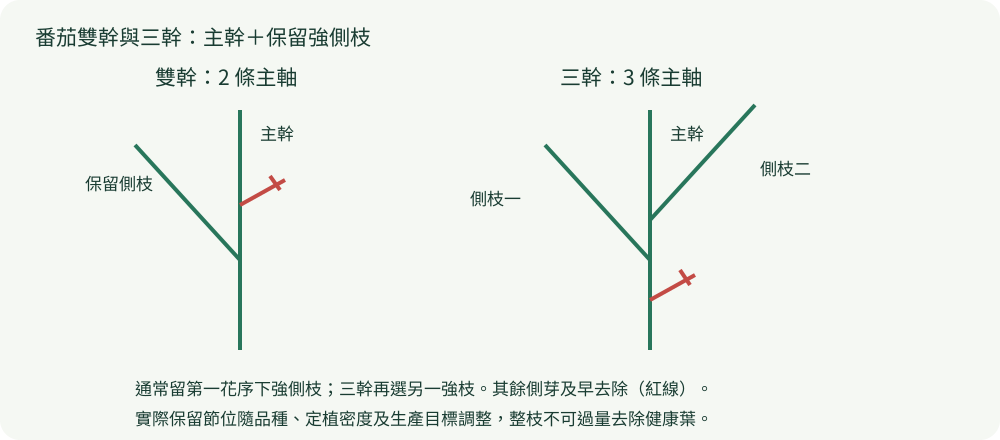

# 99 年蔬菜學｜逐題教學詳解

共 6 大題，小題合併於各大題。先理解原理，再練寫答案。配分重點為建議架構，不代表官方閱卷細則。

## 第一題｜薑分類、繁殖與耐陰（15 分）

### 題意與作答範圍

本題重點：**薑分類、繁殖與耐陰**。下列依題目主題整理答案；題幹、選項與圖表請對照[原始試卷](../../541491416.pdf#page=24)。

### 先掌握答案

薑 Zingiber officinale 的食用部為根莖，屬地下莖菜，利用帶健康芽的種薑切塊繁殖，切口處理後種植。耐陰是相對較低光仍能維持正碳平衡、適度遮蔭減熱與失水，並非不需要光；

適蔭可改善生長，但長期過陰會減光合與根莖產量，須依季節調整。

### 原理拆解：為什麼會這樣？

**先理解水勢與膨壓**

水由較高水勢流向較低水勢。細胞內溶質降低滲透勢，使水進入並建立膨壓；膨壓維持葉片挺立，也是細胞擴張的重要驅動力。因此缺水初期，即使葉片尚未明顯枯死，生長速度也可能先下降。

**由缺水到減產的連鎖**

根域變乾、葉水勢下降後，ABA 等訊號促氣孔關閉以節水；但 CO₂ 進入也減少，光合供碳受限。缺水再加重會破壞膜、酵素與運輸，造成落花落果、果實小與葉片早衰。復水後是否恢復，取決逆境強度、時間及受傷器官。

**管理不是只問澆多少**

應先看土壤保水與排水、根深、作物生育期及蒸散需求，用根域含水或水勢、植株狀態訂補水時機。覆蓋可減土面蒸發，滴灌可提高供水效率，但若根已病死或缺氧，增加灌水反而可能使吸水更差。

**健康與整齊度要從母本或種子源開始**

母株帶病、種子混雜或發芽不整齊，往往無法只靠後段管理補救。應先選品種與合格種源，建立隔離、檢測與批次追溯；外觀正常並不保證無系統性病毒。

**育苗目標是可定植且恢復快**

適度根系、適當苗齡、均衡地上部與根部，以及無重大病蟲是核心。過度氮肥使苗大且柔嫩，可能反而提高失水與病害；根滿盆、盤根或苗齡過老也會限制定植後生長。

**無菌培養後仍有馴化關卡**

瓶內高濕、低光與外加糖可使幼苗角質層、氣孔及根功能與田間不同。出瓶須逐步調整光濕條件並防感染。組培倍率、出瓶存活率與成品率應分開計算，不能只用增殖數宣稱生產效率。

### 逐項辨析：定義之外還要知道什麼

| 本題答案項目 | 解析與辨別重點 |
| --- | --- |
| 薑 Zingiber officinale 的食用部為根莖，屬地下莖菜，利用帶健康芽的種薑切塊繁殖，切口處理後種植。耐陰是相對較低光仍能維持正碳平衡、適度遮蔭減熱與失水，並非不需要光； | 是橫走的莖，具有節與芽；蓮藕、薑雖俗稱根，實際為莖。 |
| 適蔭可改善生長，但長期過陰會減光合與根莖產量，須依季節調整。 | 是橫走的莖，具有節與芽；蓮藕、薑雖俗稱根，實際為莖。 |

### 可直接練寫的完整答案

薑 Zingiber officinale 的食用部為根莖，屬地下莖菜，利用帶健康芽的種薑切塊繁殖，切口處理後種植。耐陰是相對較低光仍能維持正碳平衡、適度遮蔭減熱與失水，並非不需要光；

適蔭可改善生長，但長期過陰會減光合與根莖產量，須依季節調整。

水由較高水勢流向較低水勢。細胞內溶質降低滲透勢，使水進入並建立膨壓；膨壓維持葉片挺立，也是細胞擴張的重要驅動力。因此缺水初期，即使葉片尚未明顯枯死，生長速度也可能先下降。

### 實例：把原理用在情境中

旱後突然大水可讓部分果實內部快速吸水膨大，外皮卻來不及延展，增加裂果。因此穩定供水有時比季節總水量更能解釋商品率。

蝴蝶蘭分生苗可用組織培養大量增殖，但需檢測母株病毒並控制培養代數；出瓶後先馴化，再依葉片與根系生長分級，不宜把瓶苗數直接當成上市盆花數。

### 配分重點：哪些內容不能漏？

15 分：食用器官、帶芽繁殖、光補償與遮蔭取捨。

- **食用器官**
- **帶芽繁殖**
- **光補償與遮蔭取捨**

細項為依題意整理的建議得分內容，並非校方公布的評分細則。作答時依原題小題順序，讓定義、機制、實例與管理措施互相對應。

### 常見錯誤與修正

- 把有水等同根一定能吸到水。
- 將組織培養視為自動消除所有病原。
- 只抄中文名稱，漏掉題目要求的構造、英文、例子或區別。

## 第二題｜五菜成花條件與授粉（15 分）

### 題意與作答範圍

本題重點：**五菜成花條件與授粉**。下列依題目主題整理答案；題幹、選項與圖表請對照[原始試卷](../../541491416.pdf#page=24)。

### 先掌握答案

絲瓜多量性短日、雌雄同株異花、昆蟲授粉；

### 原理拆解：為什麼會這樣？

**感應的是日夜節律，常以夜長最關鍵**

短日植物通常需足夠長且連續的黑暗期，長日植物則在適當日長或短夜下促花；日中性不代表完全不受光量影響。須區分絕對與相對反應，以及品種、葉齡與溫度造成的差異。

**感光與光合作用不是同一需求**

暗期中斷以低強度照光便可能改變光週期訊號；補光增加每日光積量，主要補足同化需求。兩者目的、光強與操作時間不同，不能用「照燈會增產」取代成花機制。

**產期調節須兼顧可感應階段**

植株須具適當生理年齡，才能有效接受成花訊號。先在營養生長階段建立株型，再用遮光短日或夜間照光調整成花；花芽形成後仍受溫度與碳供應影響，處理日數不可跨品種硬套。

**低溫建立的是成花能力**

春化為適當低溫使植物獲得或加速成花能力的作用。並非所有低溫處理都叫春化；解除芽休眠、促球根生根與果實冷藏各有不同生理目的，必須先辨識作用組織與後續反應。

**反應取決品種與發育年齡**

種子或幼苗可感受低溫的類型，與須先達一定大小的綠體春化型不同。低溫的有效程度受溫度、持續時間、植株大小及後續條件影響；未達感應能力時，長時間低溫也不一定得到同樣效果。

**感應完成仍須完成花芽發育**

春化後的日長、溫度與營養決定抽薹和花器發育。部分植物在特定條件下有去春化反應，不能把處理完成看成保證當日開花。生產上須將育苗、低溫與後續栽培排成完整時程。

### 可直接練寫的完整答案

絲瓜多量性短日、雌雄同株異花、昆蟲授粉；

菠菜冷涼生長，長日促抽薹，常雌雄異株、風媒；

蘿蔔許多品種可早期低溫春化、長日促抽薹，十字花四瓣六雄蕊，常異交及不親和；

結球萵苣高溫長日易抽薹，頭狀花序中舌狀兩性小花，主要自交；

茄子日長反應較弱、適溫促花，兩性花常自交但可昆蟲異交。

短日植物通常需足夠長且連續的黑暗期，長日植物則在適當日長或短夜下促花；日中性不代表完全不受光量影響。須區分絕對與相對反應，以及品種、葉齡與溫度造成的差異。

暗期中斷以低強度照光便可能改變光週期訊號；補光增加每日光積量，主要補足同化需求。兩者目的、光強與操作時間不同，不能用「照燈會增產」取代成花機制。

### 實例：把原理用在情境中

菊花可先用夜間照光延長營養生長、累積足夠莖長，達規格後停止照光並提供適宜短日，使花期配合市場。單靠弱光夜照不足以補足低日照下的生長能量。

部分甘藍類須先長到足夠大小再受低溫，才能順利抽薹開花供採種；食用生產則要避免幼苗過早達感應大小後遇冷，以減少未熟抽薹。

### 配分重點：哪些內容不能漏？

15 分：各 3 分，誘導、花構造、授粉對應。

- **各 3 分，誘導**
- **花構造**
- **授粉對應**

細項為依題意整理的建議得分內容，並非校方公布的評分細則。作答時依原題小題順序，讓定義、機制、實例與管理措施互相對應。

### 常見錯誤與修正

- 把短日反應簡化為光越少花越多。
- 把低溫解除休眠與低溫誘導成花當成同義。

## 第三題｜Cole crops（10 分）

### 題意與作答範圍

本題重點：**Cole crops**。下列依題目主題整理答案；題幹、選項與圖表請對照[原始試卷](../../541491416.pdf#page=24)。

### 先掌握答案

Cole crops 通常指 Brassica oleracea 及其變種／栽培群的甘藍類，而非所有十字花菜。可列甘藍 var. capitata、花椰菜 var. botrytis、青花菜 var. italica、球莖甘藍 var. gongylodes、抱子甘藍 var. gemmifera、羽衣甘藍 var. acephala；

### 原理拆解：為什麼會這樣？

**器官來源比外觀名稱更可靠**

地下、肥大或肉質都不能單獨決定是根、莖或葉。莖常有節、節間與芽，根有根冠與根系構造，葉則依附於莖節；判讀食用或觀賞部位時，應由發育來源辨識。

**不同分類軸不能混用**

花序型依花的著生與主軸生長方式分類；果實型則看一花或多花、單個或多個子房以及附屬組織。兩性花與完全花也不同：前者具雄雌蕊，後者還須具萼與瓣。

**名稱與例子要一對一**

寫出構造後立即給正確例子，必要時補充品種或教材口徑。同俗名可能指不同植物，新舊分類也可能用不同科名；可並列通行新名與舊名，避免用俗名差異冒充生物構造差異。

### 可直接練寫的完整答案

Cole crops 通常指 Brassica oleracea 及其變種／栽培群的甘藍類，而非所有十字花菜。可列甘藍 var. capitata、花椰菜 var. botrytis、青花菜 var. italica、球莖甘藍 var. gongylodes、抱子甘藍 var. gemmifera、羽衣甘藍 var. acephala；

現行也可用相應 cultivar Group。結球白菜 B. rapa 不屬此狹義群。

地下、肥大或肉質都不能單獨決定是根、莖或葉。莖常有節、節間與芽，根有根冠與根系構造，葉則依附於莖節；判讀食用或觀賞部位時，應由發育來源辨識。

### 實例：把原理用在情境中

馬鈴薯雖在地下，薯塊有芽眼，屬莖塊莖；甘藷的肥大貯藏器官屬塊根。兩者都儲藏澱粉，不能因此判為相同器官。

### 配分重點：哪些內容不能漏？

10 分：範圍、至少五中文與學名組合、排除混淆。

- **至少五中文與學名組合**
- **排除混淆**

細項為依題意整理的建議得分內容，並非校方公布的評分細則。作答時依原題小題順序，讓定義、機制、實例與管理措施互相對應。

### 常見錯誤與修正

- 看到地下器官就全部寫成根。

## 第四題｜爆蒜（10 分）

### 題意與作答範圍

本題重點：**爆蒜**。下列依題目主題整理答案；題幹、選項與圖表請對照[原始試卷](../../541491416.pdf#page=24)。

### 先掌握答案

爆蒜主要指蒜瓣尚在母球內時又萌芽、抽葉的二次生長，使正常蒜球結構紊亂、外皮裂開或球形不整，降低商品性；

### 原理拆解：為什麼會這樣？

**爆蒜重點是鱗莖內的二次生長**

環境和管理使本應形成蒜瓣的芽或側芽繼續營養生長，產生副芽、葉片或異常分蘗，造成蒜球鬆散、外觀及貯藏性下降。不能只說乾燥後外皮破裂。品種、低溫歷程、氮與供水都可能參與，應從種蒜、播期與後期肥水穩定管理，而非單一歸因於缺水。

**先理解水勢與膨壓**

水由較高水勢流向較低水勢。細胞內溶質降低滲透勢，使水進入並建立膨壓；膨壓維持葉片挺立，也是細胞擴張的重要驅動力。因此缺水初期，即使葉片尚未明顯枯死，生長速度也可能先下降。

**由缺水到減產的連鎖**

根域變乾、葉水勢下降後，ABA 等訊號促氣孔關閉以節水；但 CO₂ 進入也減少，光合供碳受限。缺水再加重會破壞膜、酵素與運輸，造成落花落果、果實小與葉片早衰。復水後是否恢復，取決逆境強度、時間及受傷器官。

**管理不是只問澆多少**

應先看土壤保水與排水、根深、作物生育期及蒸散需求，用根域含水或水勢、植株狀態訂補水時機。覆蓋可減土面蒸發，滴灌可提高供水效率，但若根已病死或缺氧，增加灌水反而可能使吸水更差。

**用限制來源分類**

相關休眠的抑制來自芽外，如頂芽優勢；內生休眠來自芽自身，即使外面適宜仍難萌；環境休眠則是芽已有能力，但外界低溫或缺水限制。三者不能以落葉與否判斷，也不必在同株所有芽同時發生。

**冬天的冷與春天的暖做不同工作**

有效低溫累積可逐漸解除內生休眠，稱滿足需冷；解除後，芽仍須合適環境及一定熱量才能萌發。因此短暫暖冬回溫可能促進已滿冷的芽，卻無法補救尚未滿足需冷的芽。

**技術必須對應真正瓶頸**

摘心只能解除相關抑制，不能保證解除內生休眠；低需冷品種與冷地花芽穗可用來適應暖地，但花芽後續仍需合適熱量與授粉。成花誘導的低溫反應也不宜直接與落葉果樹的芽休眠需冷完全畫等號。

### 可直接練寫的完整答案

爆蒜主要指蒜瓣尚在母球內時又萌芽、抽葉的二次生長，使正常蒜球結構紊亂、外皮裂開或球形不整，降低商品性；

並非僅指乾燥後的外皮機械裂。品種、種蒜低溫處理過久、播期與溫日長配合不當，以及水氮過旺會增加風險。宜選適地品種、控制種蒜處理與播期，合理水氮、適熟採收，防止新芽提早再生。來源：[大蒜促成栽培技術](https://kmweb.moa.gov.tw/files/document/16433/cae17a8c8bed6f723470c45573f57495_v3.pdf)。

環境和管理使本應形成蒜瓣的芽或側芽繼續營養生長，產生副芽、葉片或異常分蘗，造成蒜球鬆散、外觀及貯藏性下降。不能只說乾燥後外皮破裂。品種、低溫歷程、氮與供水都可能參與，應從種蒜、播期與後期肥水穩定管理，而非單一歸因於缺水。

### 實例：把原理用在情境中

旱後突然大水可讓部分果實內部快速吸水膨大，外皮卻來不及延展，增加裂果。因此穩定供水有時比季節總水量更能解釋商品率。

平地高接梨把已在冷地完成所需低溫的花芽穗帶到暖地，利用當地較早回暖開花結果；不是讓高需冷芽在低地神奇地不再需要低溫。

### 配分重點：哪些內容不能漏？

10 分：二次生長定義、冷處理與環境營養、品種及控制方法。

- **二次生長定義**
- **冷處理與環境營養**
- **品種及控制方法**

細項為依題意整理的建議得分內容，並非校方公布的評分細則。作答時依原題小題順序，讓定義、機制、實例與管理措施互相對應。

### 常見錯誤與修正

- 把有水等同根一定能吸到水。
- 把需冷不足與萌芽後霜害混為同一問題。

## 第五題｜六簡答（30 分）

### 題意與作答範圍

本題重點：**六簡答**。下列依題目主題整理答案；題幹、選項與圖表請對照[原始試卷](../../541491416.pdf#page=24)。

### 先掌握答案

(1)馴化常使食器變大、苦毒下降、成熟整齊、休眠／落粒減少、株型適收五方向。

### 原理拆解：為什麼會這樣？

**產量要以單位土地和有效葉面積看**

大樹不一定比小冠密植高產，因為冠內葉片可能長期受陰。產量與品質取決土地截光、光分布、葉片利用效率，以及同化物分給果實的比例；單株產量與每公頃產量必須分別討論。

**整枝、修剪和負載互相制約**

整枝建立骨架與結果部位，修剪移除特定枝芽葉，拉枝改變角度與優勢，疏果降低庫競爭。操作須保留足量健康葉；過重剪雖降低高度，卻會減供碳並促旺梢，不保證提高當期花果。

**矮化與密植的效益有條件**

矮砧、低幹與細長冠可早形成土地有效葉面積、方便作業，且減大型骨架消耗；但過密仍會陰蔽、著色差與病害。支架、灌溉、疏果及持續更新是技術成本，不應只列早產優點。

**先理解水勢與膨壓**

水由較高水勢流向較低水勢。細胞內溶質降低滲透勢，使水進入並建立膨壓；膨壓維持葉片挺立，也是細胞擴張的重要驅動力。因此缺水初期，即使葉片尚未明顯枯死，生長速度也可能先下降。

**由缺水到減產的連鎖**

根域變乾、葉水勢下降後，ABA 等訊號促氣孔關閉以節水；但 CO₂ 進入也減少，光合供碳受限。缺水再加重會破壞膜、酵素與運輸，造成落花落果、果實小與葉片早衰。復水後是否恢復，取決逆境強度、時間及受傷器官。

**管理不是只問澆多少**

應先看土壤保水與排水、根深、作物生育期及蒸散需求，用根域含水或水勢、植株狀態訂補水時機。覆蓋可減土面蒸發，滴灌可提高供水效率，但若根已病死或缺氧，增加灌水反而可能使吸水更差。

### 可直接練寫的完整答案

(1)馴化常使食器變大、苦毒下降、成熟整齊、休眠／落粒減少、株型適收五方向。

(2)密度提高早期截光與單位面積產量，過密則單株弱、病害及商品率降。

(3)蘿蔔空心常為髓部老化、快速膨大而同化物不足、水熱與過熟使組織分離。

(4)豆菜多具豆莢、根瘤共生潛力、蛋白較豐富，但不同種耐熱與授粉不同。

(5)番茄耐熱應在高溫仍維持花粉活力、正常受精著果與合格品質，而非只葉不萎。

(6)雙幹保留主幹與第一花序下強側枝，三幹再留一強側枝，其他側芽及早去除，圖畫主軸分成二／三條並標保留點。

大樹不一定比小冠密植高產，因為冠內葉片可能長期受陰。產量與品質取決土地截光、光分布、葉片利用效率，以及同化物分給果實的比例；單株產量與每公頃產量必須分別討論。

### 圖解輔助

示意圖用來理解結構與方向；考場仍須依原題標示軸名、箭頭或構造。

### 實例：把原理用在情境中

矮砧蘋果密植常可提高早期每公頃產量，即使單株產量較低；若後期冠層封閉卻不調枝，早期優勢會被陰蔽與品質下降抵銷。

旱後突然大水可讓部分果實內部快速吸水膨大，外皮卻來不及延展，增加裂果。因此穩定供水有時比季節總水量更能解釋商品率。

### 配分重點：哪些內容不能漏？

30 分：六題各 5 分，依原題作特定回答，末題附分枝圖。

細項為依題意整理的建議得分內容，並非校方公布的評分細則。作答時依原題小題順序，讓定義、機制、實例與管理措施互相對應。

### 常見錯誤與修正

- 把修剪一律理解為越重越好。
- 把有水等同根一定能吸到水。

## 第六題｜結球英文翻譯（20 分）

### 題意與作答範圍

本題重點：**結球英文翻譯**。下列依題目主題整理答案；題幹、選項與圖表請對照[原始試卷](../../541491416.pdf#page=24)。

### 先掌握答案

這是一題全文翻譯，應保留原文的研究對象、因果、比較、數量與限制。下列譯文按意思分段，術語解析另列。

### 完整參考譯文

結球藉自身遮蔭引起的軟白化改善葉片可食性。甘藍、結球萵苣與結球白菜等是全球重要葉菜，結球顯然也是其遺傳改良的重要性狀。已有報告指出光照是影響直立葉形成的環境因子：甘藍去外葉會使球葉展開而不結球，但若以紙圍住並遮蔭裸露葉球，仍能維持結球。這表示外葉遮蔭使內葉接受低光，是結球必要條件之一。更直接證據為幼年大白菜移入黑暗時葉變直立，但葉背受光時又呈水平方向。

### 讀懂這段研究在說什麼

**遮光試驗支持的是局部環境效應**

外葉本身可造成內部遮蔭；去外葉後不結球，再補人工遮蔭若能恢復，支持光環境參與葉片直立與結球。這不等於全株長期黑暗更有利，因外葉仍提供同化物。翻譯要保留處理與對照，以及甘藍、萵苣、白菜不同材料的表述。

### 專業詞彙與翻譯辨析

| 英文用語 | 建議譯法 | 讀法與限制 |
| --- | --- | --- |
| heading | 結球 | 葉片形成球狀結構，非開花結實 |
| blanching / etiolation，依原文 | 軟白化 | 遮光使組織嫩白，需依語境翻譯 |

### 配分重點與檢查順序

20 分：自身遮蔭、三葉菜、去外葉與紙遮對照、葉背受光方向。

先檢查是否漏譯整句，再核對否定詞、比較對象、百分比和溫度。研究原文中的「可能」「顯著」「潛力」不可任意改成保證效果；譯文如提到健康或產業效益，應保留為原文陳述，不擴寫成額外建議。

### 常見失分

- 把專業名詞按一般字義翻譯，或把相關性改成因果。
- 省略轉折、條件或限制，使研究結論比原文更強。
- 以摘要取代全文翻譯。
